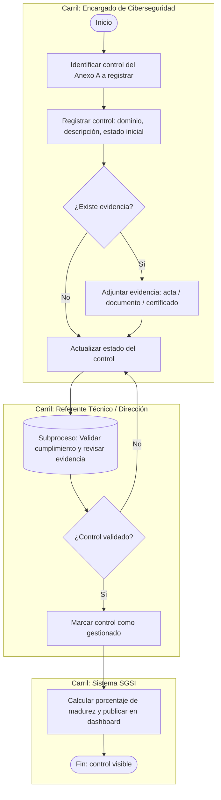
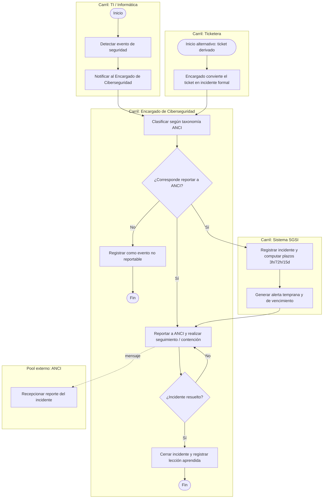
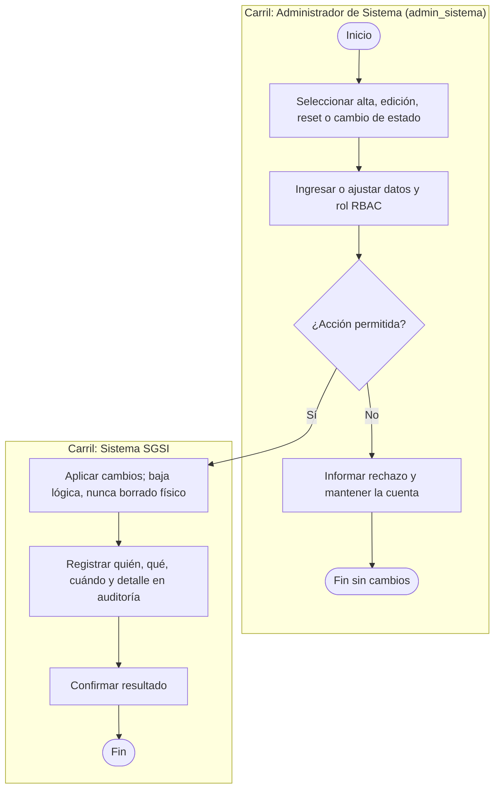
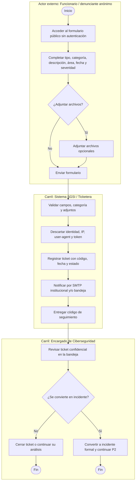

# 3. Diagramas BPMN de los procesos de negocio

> **Entregable 3 — Evaluación Sumativa 2 (ES2), Unidad 2 (Desarrollo e Implementación)**
> **Proyecto:** SGSI — Sistema de Gestión de Seguridad de la Información
> **Mandante:** Hospital Félix Bulnes Cerda (Miguel Godoy, Encargado de Ciberseguridad)
> **Criterio evaluado:** `2.1.2.3` — BPMN de cinco procesos principales con sus subprocesos.

Este entregable modela **cinco procesos principales** del negocio mediante notación BPMN 2.0, cada
uno con sus **subprocesos**, **actores (pools/carriles)**, **eventos**, **tareas**, **compuertas** y
**flujos de mensaje**. Cada proceso se entrega en dos formatos:

- **Mermaid** (incrustado aquí): se visualiza directamente en GitHub/VS Code.
- **`.drawio`**: archivo editable para abrir en draw.io (ver carpeta `03_bpmn/`).

---

## 3.1 Procesos seleccionados

| # | Proceso principal | Subprocesos | Archivo `.drawio` |
|---|---|---|---|
| P1 | Gestión de controles ISO/IEC 27001 | Registrar control, gestionar evidencia, actualizar estado, validar y aprobar, publicar madurez | `03a_proceso_controles_iso27001.drawio` |
| P2 | Gestión de incidentes de ciberseguridad | Clasificar (taxonomía ANCI), computar plazos, alertar, reportar, contener, cerrar | `03b_proceso_incidentes.drawio` |
| P3 | Gestión de terceros/proveedores (cláusulas de seguridad) | Registrar contrato, revisar checklist, verificar cumplimiento, corregir, publicar estado | `03c_proceso_terceros.drawio` |
| P4 | Gestión de usuarios | Alta, edición, restablecimiento de contraseña, habilitación/deshabilitación y auditoría | `03d_proceso_usuarios.drawio` |
| P5 | Gestión de tickets (denuncias y reportes) | Capturar formulario público, validar y anonimizar, notificar, analizar, derivar a incidente o cerrar | `03e_proceso_tickets.drawio` |

**Notación utilizada:** piscinas (pools) para organizaciones externas, carriles (lanes) para roles
internos, círculo = evento, rectángulo = tarea, rectángulo con borde marcado = subproceso, rombo =
compuerta exclusiva (XOR), flecha punteada = flujo de mensaje, flecha continua = flujo de secuencia.

---

## 3.2 Proceso P1 — Gestión de controles ISO/IEC 27001

### Descripción

El Encargado de Ciberseguridad registra en el SGSI cada control del Anexo A de ISO/IEC 27001,
indicando su dominio (organizacional, personas, físico, tecnológico), descripción y estado inicial.
Si existe evidencia, se adjunta el documento de respaldo; luego se actualiza el estado (no iniciado /
iniciado / implementado / gestionado). El Referente Técnico o la Dirección validan la evidencia y,
si es aprobada, el control se marca como gestionado; en caso contrario vuelve a actualizarse. El
sistema recalcula el porcentaje de madurez y lo publica en el dashboard.

### Actores

| Actor | Tipo | Responsabilidad |
|---|---|---|
| Encargado de Ciberseguridad | Carril (interno) | Registrar controles, adjuntar evidencia, actualizar estado |
| Referente Técnico / Dirección | Carril (interno) | Validar cumplimiento y aprobar |
| Sistema SGSI | Carril (sistema) | Calcular madurez y publicar dashboard |

### Subprocesos

| Subproceso | Descripción |
|---|---|
| S1.1 Registrar control | Alta del control con dominio, descripción y estado inicial |
| S1.2 Gestionar evidencia | Adjuntar/retirar archivos de evidencia (acta, documento, certificado) |
| S1.3 Actualizar estado | Cambio de estado según nivel de avance (no iniciado → iniciado → implementado → gestionado) |
| S1.4 Validar y aprobar | Revisión de la evidencia y aprobación/rechazo del cumplimiento |
| S1.5 Publicar madurez | Recálculo del % de madurez por dominio/global y visualización en el dashboard |

### Diagrama (Mermaid)

> **Archivo editable:** `03_bpmn/03a_proceso_controles_iso27001.drawio`

---

## 3.3 Proceso P2 — Gestión de incidentes de ciberseguridad

### Descripción

El proceso puede iniciarse por dos orígenes: un evento de seguridad detectado por TI (p. ej. falla en
Trakcare, intento de ataque), o un ticket de denuncia/reporte que el Encargado de Ciberseguridad
convierte en incidente formal desde la ticketera. En ambos casos, el encargado clasifica según la
**taxonomía ANCI** (tipo, alcance, severidad); el incidente derivado conserva la descripción y
severidad del ticket. Si el evento no cumple los criterios para ser reportable, se registra como no reportable
y finaliza. Si corresponde reportar, el SGSI registra el incidente, **computa los plazos legales** de
la Ley 21.663 (alerta temprana 3 h; reporte 72 h para severidad alta/crítica o 15 días para
media/baja) y genera las alertas de vencimiento. El encargado **reporta al portal de la ANCI** y
realiza el seguimiento/contención hasta el cierre, dejando registro de la lección aprendida.

### Actores

| Actor | Tipo | Responsabilidad |
|---|---|---|
| TI / Informática (mesa de ayuda) | Carril (interno) | Detectar y notificar eventos |
| Encargado de Ciberseguridad | Carril (interno) | Clasificar, reportar, contener y cerrar |
| Sistema SGSI | Carril (sistema) | Computar plazos y alertar vencimientos |
| Ticketera | Proceso de origen alternativo | Entregar al encargado un ticket convertido en incidente formal |
| ANCI | Pool externo | Recepcionar el reporte oficial |

### Subprocesos

| Subproceso | Descripción |
|---|---|
| S2.1 Clasificar incidente | Aplicar taxonomía ANCI (tipo, alcance, severidad) |
| S2.2 Computar plazos legales | Calcular alerta temprana (3 h) y plazos de reporte (72 h / 15 días) |
| S2.3 Alertar vencimientos | Generar alertas de vencimiento de plazos |
| S2.4 Reportar a ANCI | Emitir el reporte oficial en el portal de la ANCI |
| S2.5 Contener y cerrar | Seguimiento/contención, cierre y lección aprendida |

### Diagrama (Mermaid)

> **Archivo editable:** `03_bpmn/03b_proceso_incidentes.drawio`

---

## 3.4 Procesos principales P3, P4 y P5

### Proceso P3 — Gestión de terceros/proveedores (cláusulas de seguridad)

### Descripción

El Administrador de Contratos recepciona un contrato o bases de licitación y registra al tercero. El
Encargado de Ciberseguridad revisa el **checklist de cláusulas de seguridad** exigidas al proveedor.
Si faltan cláusulas, se solicita el ajuste al proveedor, quien corrige y reenvía el contrato. Cuando
el checklist está completo, se verifica el cumplimiento con la documentación de respaldo; si no
cumple, se marca "no conforme" con plan de acción, y si cumple, se marca "conforme/habilitado" y se
publica el estado en el reporte de terceros.

### Actores

| Actor | Tipo | Responsabilidad |
|---|---|---|
| Administrador de Contratos | Carril (interno) | Recepcionar y registrar contratos/licitaciones |
| Encargado de Ciberseguridad | Carril (interno) | Revisar checklist, verificar cumplimiento y publicar estado |
| Proveedor / Tercero | Pool externo | Corregir/incorporar cláusulas de seguridad |

### Subprocesos

| Subproceso | Descripción |
|---|---|
| S3.1 Registrar contrato | Ingreso del tercero y del contrato/licitación |
| S3.2 Revisar checklist | Verificación de cláusulas de seguridad presentes en el contrato |
| S3.3 Verificar cumplimiento | Validación con documentación de respaldo |
| S3.4 Corregir contrato | Solicitud de ajuste al proveedor y recepción de correcciones |
| S3.5 Publicar estado | Actualizar estado (conforme / no conforme) y reporte de terceros |

### Diagrama (Mermaid)

> **Archivo editable:** `03_bpmn/03c_proceso_terceros.drawio`

---

### Proceso P4 — Gestión de usuarios

#### Descripción

El Administrador de Sistema (`admin_sistema`) administra cuentas existentes y nuevas: crea usuarios, modifica nombre, username o rol, restablece contraseñas y habilita o deshabilita cuentas. La baja es lógica (campo `activo`), sin borrado físico. El sistema impide deshabilitar la cuenta en sesión y deshabilitar o degradar al último `admin_sistema` activo; una cuenta deshabilitada no puede iniciar sesión ni usar su token. Cada alta, edición, cambio de rol, reset y cambio de estado queda en auditoría (`quién`, `qué`, `cuándo` y detalle). Ningún otro rol accede al módulo.

#### Actores

| Actor | Tipo | Responsabilidad |
|---|---|---|
| Administrador de Sistema (`admin_sistema`) | Carril (interno) | Crear, editar, restablecer credenciales y habilitar/deshabilitar usuarios |
| Sistema SGSI | Carril (sistema) | Validar reglas, aplicar cambios y registrar auditoría |

#### Subprocesos

| Subproceso | Descripción |
|---|---|
| S4.1 Listar y consultar usuarios | Consultar cuentas y estado activo/inactivo |
| S4.2 Crear y editar cuenta | Mantener username, nombre completo, contraseña inicial y rol |
| S4.3 Restablecer contraseña | Emitir o definir credencial inicial de restablecimiento |
| S4.4 Habilitar o deshabilitar | Cambiar estado con baja lógica; impedir auto-desactivación y deshabilitación o degradación del último administrador activo |
| S4.5 Auditar cambios | Registrar actor, acción, objetivo, fecha y detalle sin eliminar historial |

#### Diagrama (Mermaid)

> **Archivo editable:** `03_bpmn/03d_proceso_usuarios.drawio`

### Proceso P5 — Gestión de tickets (denuncias y reportes de incidentes)

#### Descripción

Un funcionario del hospital o denunciante accede al formulario público sin autenticación, completa tipo (denuncia o reporte), categoría, descripción, sistema/área, fecha y hora aproximadas, severidad percibida y, opcionalmente, adjuntos. La categoría `Otros` exige texto libre. El sistema valida los datos y archivos, aplica límites de solicitudes y descarta identidad, IP, user-agent y token del emisor; registra un ticket trazable mediante código, fecha y estado, y entrega un código de seguimiento. Se envía aviso al equipo de ciberseguridad por los medios seleccionados (correo SMTP institucional y/o bandeja); el correo contiene solo metadatos mínimos. Únicamente `encargado` puede revisar el contenido confidencial, cambiar estados y decidir su cierre o derivación a un incidente P2. La consulta pública del estado por código no revela datos sensibles.

#### Actores

| Actor | Tipo | Responsabilidad |
|---|---|---|
| Funcionario del hospital / denunciante | Actor externo no autenticado | Enviar denuncia o reporte de forma anónima por el formulario público |
| Sistema SGSI / Ticketera | Carril (sistema) | Validar, anonimizar, registrar el ticket, notificar y emitir código de seguimiento |
| Encargado de Ciberseguridad | Carril (interno) | Revisar contenido, gestionar estados, cerrar o convertir en incidente |

#### Subprocesos

| Subproceso | Descripción |
|---|---|
| S5.1 Completar formulario | Registrar tipo, categoría, hecho, área, fecha aproximada y severidad; permitir `Otros` con texto libre |
| S5.2 Validar adjuntos | Aceptar archivos opcionales con lista blanca de tipos y límites de tamaño |
| S5.3 Anonimizar y registrar | No asociar identidad, IP, user-agent ni token; emitir código, fecha y estado |
| S5.4 Notificar equipo | Usar correo institucional y/o bandeja interna según selección; mantener creación ante falla SMTP |
| S5.5 Analizar ticket | Revisar confidencialmente y gestionar el ciclo registrado → en análisis → derivado a incidente/cerrado |
| S5.6 Derivar a incidente | Crear incidente formal según ANCI y continuar el proceso P2 |
| S5.7 Consultar estado | Permitir consulta pública por código de seguimiento sin datos sensibles |

#### Diagrama (Mermaid)

> **Archivo editable:** `03_bpmn/03e_proceso_tickets.drawio`

## 3.5 Archivos `.drawio` generados

Los siguientes archivos se encuentran en la carpeta `03_bpmn/` y pueden abrirse directamente en
draw.io (escritorio o web) para su edición y exportación:

| Archivo | Proceso |
|---|---|
| `03_bpmn/03a_proceso_controles_iso27001.drawio` | P1 — Gestión de controles ISO/IEC 27001 |
| `03_bpmn/03b_proceso_incidentes.drawio` | P2 — Gestión de incidentes de ciberseguridad |
| `03_bpmn/03c_proceso_terceros.drawio` | P3 — Gestión de terceros/proveedores |
| `03_bpmn/03d_proceso_usuarios.drawio` | P4 — Gestión de usuarios |
| `03_bpmn/03e_proceso_tickets.drawio` | P5 — Gestión de tickets (denuncias y reportes) |

> **Nota:** los archivos `.drawio` usan la biblioteca de formas estándar (piscinas, carriles, tareas,
> eventos y compuertas) para una edición ágil. Si se requiere la notación BPMN 2.0 completa con
> íconos específicos, en draw.io se puede activar la biblioteca **"BPMN 2.0"** (`+ Más formas → BPMN`)
> y reemplazar cada forma por su equivalente BPMN manteniendo la estructura ya definida.
