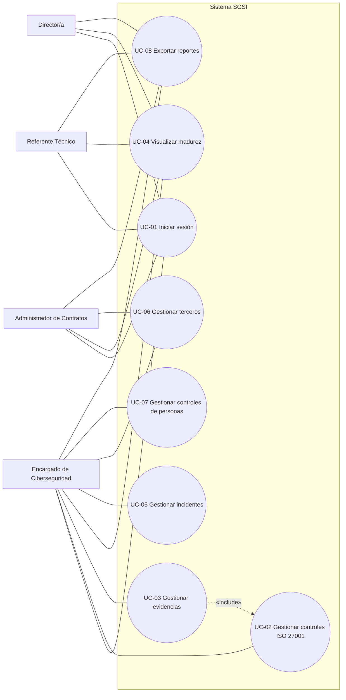
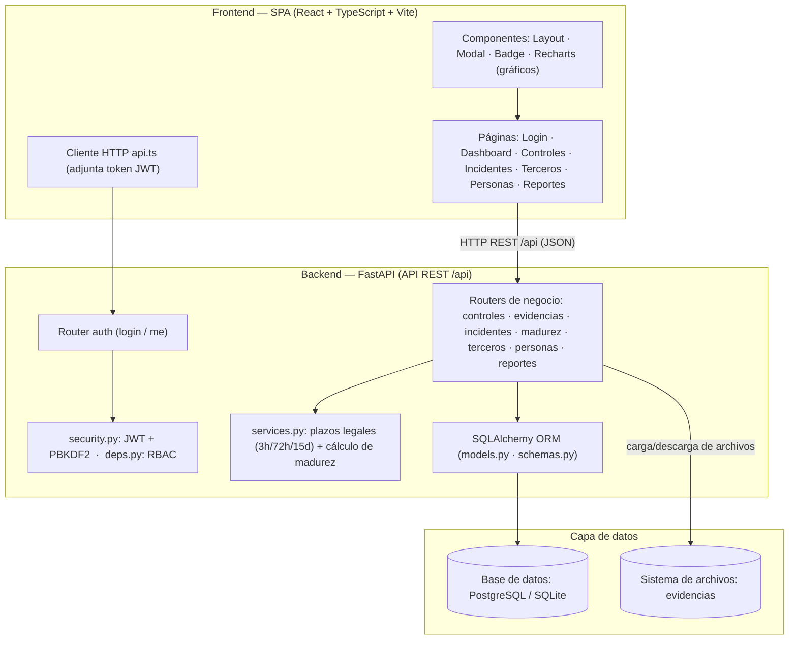

# 4. Diagramas UML: casos de uso y componentes

> **Entregable 4 — Evaluación Sumativa 2 (ES2), Unidad 2 (Desarrollo e Implementación)**
> **Proyecto:** SGSI — Sistema de Gestión de Seguridad de la Información
> **Mandante:** Hospital Félix Bulnes Cerda (Miguel Godoy, Encargado de Ciberseguridad)
> **Criterio evaluado:** `2.1.2.4` — Diagramas UML de casos de uso (con descripción) y de componentes.

Este entregable contiene el **diagrama de casos de uso** (actores, casos de uso y su descripción
detallada) y el **diagrama de componentes** de la solución, ambos alineados con la implementación
real del sistema (`sgsi/`). Cada diagrama se entrega en **Mermaid** (visible en GitHub/VS Code) y en
**`.drawio`** editable (carpeta `04_uml/`).

---

## 4.1 Diagrama de casos de uso

### 4.1.1 Actores

| Actor | Rol en el sistema (RBAC) | Permisos |
|---|---|---|
| **Encargado de Ciberseguridad** | `encargado` | Escritura y lectura en todos los módulos (controles, evidencias, incidentes, terceros, personas, reportes). |
| **Administrador de Contratos** | `admin_contratos` | Escritura en Terceros; lectura en el resto de módulos. |
| **Referente Técnico** | `referente_tecnico` | Solo lectura y exportación de reportes. |
| **Director/a** | `director` | Solo lectura y exportación de reportes. |

> Los actores externos (ANCI y Proveedor) no son usuarios del SGSI: interactúan con el hospital por
> canales institucionales (portal ANCI, correo/contratos), por lo que no forman parte del diagrama de
> casos de uso, sino de los diagramas BPMN (Entregable 3).

### 4.1.2 Diagrama (Mermaid — aproximación de UML)

> Mermaid no tiene notación nativa de casos de uso; se usa un grafo equivalente: los casos de uso son
> óvalos dentro de la frontera del sistema y los actores se conectan con líneas. La versión UML
> estricta está en `04_uml/04a_uml_casos_de_uso.drawio`.

### 4.1.3 Descripción de los casos de uso

#### UC-01 — Iniciar sesión

| Campo | Detalle |
|---|---|
| Actores | Todos |
| Precondición | Usuario registrado en la base de datos con rol asignado |
| Flujo principal | 1) El usuario ingresa usuario y contraseña en la pantalla de Login; 2) la SPA envía `POST /api/auth/login`; 3) el backend valida las credenciales (hash PBKDF2) y emite un token JWT con el rol; 4) la SPA almacena el token y redirige al Dashboard. |
| Flujo alternativo | Credenciales inválidas → el sistema muestra mensaje de error y no emite token. |
| Postcondición | Usuario autenticado con token JWT; el acceso a funciones queda restringido según su rol (RBAC). |

#### UC-02 — Gestionar controles ISO/IEC 27001

| Campo | Detalle |
|---|---|
| Actor | Encargado de Ciberseguridad |
| Precondición | Sesión iniciada con rol `encargado` |
| Flujo principal | 1) Listar controles (`GET /api/controles` con filtros dominio/estado/búsqueda); 2) crear control (`POST`); 3) editar estado o descripción (`PUT /{id}`); 4) eliminar (`DELETE /{id}`). |
| Postcondición | Catálogo de controles del Anexo A actualizado y trazable. |

#### UC-03 — Gestionar evidencias

| Campo | Detalle |
|---|---|
| Actor | Encargado (adjuntar); cualquier usuario autenticado (descargar) |
| Precondición | Existir un control registrado (UC-02) |
| Flujo principal | 1) Adjuntar archivo de evidencia (`POST /api/controles/{id}/evidencias`, multipart); 2) descargar evidencia (`GET /api/evidencias/{id}/download`). |
| Relación | «include» sobre UC-02 (la evidencia siempre se asocia a un control). |
| Postcondición | Evidencia asociada al control y disponible para descarga/auditoría. |

#### UC-04 — Visualizar madurez del SGSI

| Campo | Detalle |
|---|---|
| Actores | Todos |
| Precondición | Sesión iniciada; existen controles con estados registrados |
| Flujo principal | 1) Consultar `GET /api/madurez`; 2) la SPA renderiza gráficos de torta y barras por dominio y consolidado. |
| Postcondición | Porcentaje de madurez global y por dominio visible para la Dirección y reguladores. |

#### UC-05 — Gestionar incidentes

| Campo | Detalle |
|---|---|
| Actor | Encargado de Ciberseguridad |
| Precondición | Sesión iniciada con rol `encargado` |
| Flujo principal | 1) Registrar incidente con taxonomía ANCI (severidad, alcance, tipo); 2) el sistema computa los plazos legales (alerta temprana 3 h; reporte 72 h severidad alta/crítica o 15 días media/baja); 3) generar alertas de vencimiento; 4) editar estado (`PUT /{id}`) y eliminar (`DELETE /{id}`). |
| Postcondición | Incidente clasificado con plazos de reporte calculados y alertas de vencimiento. |

#### UC-06 — Gestionar terceros/proveedores

| Campo | Detalle |
|---|---|
| Actores | Encargado de Ciberseguridad y Administrador de Contratos |
| Precondición | Sesión iniciada con rol `encargado` o `admin_contratos` |
| Flujo principal | 1) Registrar contrato/licitación con checklist de cláusulas de seguridad (`POST /api/terceros`); 2) actualizar estado de cumplimiento (`PUT /{id}`); 3) eliminar (`DELETE /{id}`). |
| Postcondición | Terceros con cláusulas de seguridad verificadas y estado de cumplimiento registrado. |

#### UC-07 — Gestionar controles de personas

| Campo | Detalle |
|---|---|
| Actor | Encargado de Ciberseguridad |
| Precondición | Sesión iniciada con rol `encargado` |
| Flujo principal | 1) Registrar control del ciclo de vida del personal (capacitación, verificación de antecedentes, condiciones de empleo, proceso disciplinario, término de contrato, confidencialidad); 2) actualizar estado (`PUT /{id}`); 3) eliminar (`DELETE /{id}`). |
| Postcondición | Dominio "Personas" del Anexo A evidenciado y trazable. |

#### UC-08 — Exportar reportes

| Campo | Detalle |
|---|---|
| Actores | Todos |
| Precondición | Sesión iniciada |
| Flujo principal | 1) Consultar resumen ejecutivo (`GET /api/reportes/resumen`); 2) exportar CSV por módulo: controles, incidentes, terceros y personas (`GET /api/reportes/{modulo}.csv`). |
| Postcondición | Archivo CSV (compatible con Excel) descargado para sustentar el indicador de gestión y auditorías. |

---

## 4.2 Diagrama de componentes

### 4.2.1 Descripción

La solución sigue una **arquitectura monolítica modular en 3 capas**:

- **Frontend (SPA):** interfaz React + TypeScript con páginas por módulo, componentes reutilizables y
  un cliente HTTP que adjunta el token JWT en cada petición.
- **Backend (API REST):** aplicación FastAPI compuesta por routers por módulo, capa de seguridad
  (JWT/PBKDF2 + RBAC), capa de servicios (reglas de madurez y plazos legales) y ORM SQLAlchemy.
- **Capa de datos:** base de datos relacional (PostgreSQL/SQLite) y sistema de archivos para las
  evidencias.

### 4.2.2 Diagrama (Mermaid)

### 4.2.3 Descripción de componentes

| Componente | Tipo | Responsabilidad |
|---|---|---|
| Páginas SPA | Frontend | Interfaz de cada módulo (Login, Dashboard, Controles, Incidentes, Terceros, Personas, Reportes). |
| Componentes UI | Frontend | Elementos reutilizables (Layout, Modal, Badge) y gráficos Recharts. |
| Cliente HTTP `api.ts` | Frontend | Peticiones a la API adjuntando el token JWT. |
| Router `auth` | Backend | Inicio de sesión y consulta del usuario autenticado. |
| Routers de negocio | Backend | Endpoints CRUD por módulo (`controles`, `evidencias`, `incidentes`, `madurez`, `terceros`, `personas`, `reportes`). |
| `security.py` + `deps.py` | Backend | Hash de contraseñas, emisión/verificación JWT y control de acceso por roles (RBAC). |
| `services.py` | Backend | Reglas de negocio: plazos legales de incidentes y cálculo del % de madurez. |
| ORM (`models.py` + `schemas.py`) | Backend | Mapeo de entidades a tablas y validación de esquemas (Pydantic). |
| Base de datos | Datos | Persistencia relacional de controles, incidentes, terceros, personas y usuarios. |
| Sistema de archivos | Datos | Almacenamiento de las evidencias adjuntas. |

---

## 4.3 Archivos `.drawio` generados

| Archivo | Diagrama |
|---|---|
| `04_uml/04a_uml_casos_de_uso.drawio` | Casos de uso (actores, frontera del sistema, relaciones «include») |
| `04_uml/04b_uml_componentes.drawio` | Componentes (3 capas con interfaces) |

> **Nota:** los archivos `.drawio` usan formas estándar para una edición ágil. Para notación UML
> estricta (íconos de actor, óvalos de caso de uso, componentes con estereotipos), en draw.io activa
> la biblioteca **"UML"** (`+ Más formas → Software → UML`) y reemplaza cada forma manteniendo la
> estructura definida.
