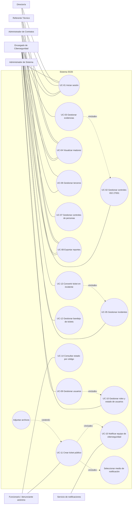
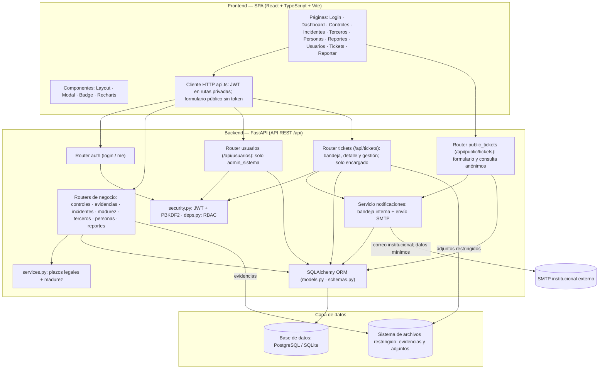

# 4. Diagramas UML: casos de uso y componentes

> **Entregable 4 — Evaluación Sumativa 2 (ES2), Unidad 2 (Desarrollo e Implementación)**
> **Proyecto:** SGSI — Sistema de Gestión de Seguridad de la Información
> **Mandante:** Hospital Félix Bulnes Cerda (Miguel Godoy, Encargado de Ciberseguridad)
> **Criterio evaluado:** `2.1.2.4` — Diagramas UML de casos de uso (con descripción) y de componentes.

Este entregable contiene el **diagrama de casos de uso** (actores, casos de uso y su descripción
detallada) y el **diagrama de componentes** de la solución, actualizados para el alcance aprobado de
los módulos existentes y los módulos Usuarios y Ticketera. Cada diagrama se entrega en **Mermaid** (visible en GitHub/VS Code) y en
**`.drawio`** editable (carpeta `04_uml/`).

---

## 4.1 Diagrama de casos de uso

### 4.1.1 Actores

| Actor | Rol en el sistema (RBAC) | Permisos |
|---|---|---|
| **Encargado de Ciberseguridad** | `encargado` | Lectura y escritura en los módulos de negocio: controles, evidencias, incidentes, terceros, personas, reportes y tickets. Es el único rol que accede al contenido y ciclo de vida de los tickets. |
| **Administrador de Contratos** | `admin_contratos` | Escritura en Terceros y lectura en los módulos de negocio restantes según sus permisos. Sin acceso a administración de usuarios ni a tickets. |
| **Referente Técnico** | `referente_tecnico` | Solo lectura y exportación de reportes. Sin acceso a usuarios ni al contenido de tickets. |
| **Director/a** | `director` | Solo lectura y exportación de reportes. Sin acceso a usuarios ni al contenido de tickets. |
| **Administrador de Sistema** | `admin_sistema` | Gestión técnica de usuarios y acceso a su propio perfil. No accede a controles ni incidentes de negocio, ni ve o gestiona contenido de tickets. |
| **Funcionario del hospital / denunciante** | No aplica: actor externo, sin autenticación | Accede al formulario público `/reportar` y consulta estado mediante código de seguimiento; no necesita ni utiliza cuenta SGSI. |

Los cinco roles autenticados tienen acceso a iniciar sesión (UC-01), cada uno con permisos diferenciados. La gestión de usuarios está reservada a `admin_sistema`. La bandeja de tickets y su contenido se reservan a `encargado`; la administración técnica no obtiene acceso a denuncias.

> ANCI y Proveedor no son usuarios del SGSI: interactúan con el hospital por canales institucionales (portal ANCI, correo/contratos), por lo que no forman parte de estos casos de uso, sino de los diagramas BPMN (Entregable 3). El formulario público es una excepción expresa a la autenticación y no habilita acceso anónimo al resto del sistema.

### 4.1.2 Diagrama (Mermaid — aproximación de UML)

> Mermaid no tiene notación nativa de casos de uso; se usa un grafo equivalente: los casos de uso son
> óvalos dentro de la frontera del sistema y los actores se conectan con líneas. La versión UML
> estricta está en `04_uml/04a_uml_casos_de_uso.drawio`.

### 4.1.3 Descripción de los casos de uso

#### UC-01 — Iniciar sesión

| Campo | Detalle |
|---|---|
| Actores | Los cinco roles autenticados: `encargado`, `admin_contratos`, `referente_tecnico`, `director` y `admin_sistema`. El actor anónimo no inicia sesión y utiliza UC-11/UC-14. |
| Precondición | Usuario registrado en la base de datos, habilitado y con rol asignado |
| Flujo principal | 1) El usuario ingresa usuario y contraseña en la pantalla de Login; 2) la SPA envía `POST /api/auth/login`; 3) el backend valida las credenciales (hash PBKDF2) y emite un token JWT con el rol; 4) la SPA almacena el token y redirige al Dashboard. |
| Flujo alternativo | Credenciales inválidas → el sistema muestra mensaje de error y no emite token. |
| Postcondición | Usuario autenticado con token JWT; el acceso a funciones queda restringido según su rol (RBAC). |

#### UC-02 — Gestionar controles ISO/IEC 27001

| Campo | Detalle |
|---|---|
| Actor | Encargado de Ciberseguridad |
| Precondición | Sesión iniciada con rol `encargado` |
| Flujo principal | 1) Listar controles (`GET /api/controles` con filtros dominio/estado/búsqueda); 2) crear control (`POST`); 3) editar estado o descripción (`PUT /{id}`); 4) eliminar (`DELETE /{id}`). |
| Postcondición | Catálogo de controles del Anexo A actualizado y trazable. |

#### UC-03 — Gestionar evidencias

| Campo | Detalle |
|---|---|
| Actor | Encargado (adjuntar); cualquier rol de negocio autenticado con permiso de descarga, excluido `admin_sistema` |
| Precondición | Existir un control registrado (UC-02) |
| Flujo principal | 1) Adjuntar archivo de evidencia (`POST /api/controles/{id}/evidencias`, multipart); 2) descargar evidencia (`GET /api/evidencias/{id}/download`). |
| Relación | «include» sobre UC-02 (la evidencia siempre se asocia a un control). |
| Postcondición | Evidencia asociada al control y disponible para descarga/auditoría. |

#### UC-04 — Visualizar madurez del SGSI

| Campo | Detalle |
|---|---|
| Actores | Los cuatro roles de negocio autenticados con permiso de consulta; no incluye `admin_sistema` ni al actor anónimo. |
| Precondición | Sesión iniciada; existen controles con estados registrados |
| Flujo principal | 1) Consultar `GET /api/madurez`; 2) la SPA renderiza gráficos de torta y barras por dominio y consolidado. |
| Postcondición | Porcentaje de madurez global y por dominio visible para la Dirección y reguladores. |

#### UC-05 — Gestionar incidentes

| Campo | Detalle |
|---|---|
| Actor | Encargado de Ciberseguridad |
| Precondición | Sesión iniciada con rol `encargado` |
| Flujo principal | 1) Registrar incidente con taxonomía ANCI (severidad, alcance, tipo); 2) el sistema computa los plazos legales (alerta temprana 3 h; reporte 72 h severidad alta/crítica o 15 días media/baja); 3) generar alertas de vencimiento; 4) editar estado (`PUT /{id}`) y eliminar (`DELETE /{id}`). |
| Postcondición | Incidente clasificado con plazos de reporte calculados y alertas de vencimiento. |

#### UC-06 — Gestionar terceros/proveedores

| Campo | Detalle |
|---|---|
| Actores | Encargado de Ciberseguridad y Administrador de Contratos |
| Precondición | Sesión iniciada con rol `encargado` o `admin_contratos` |
| Flujo principal | 1) Registrar contrato/licitación con checklist de cláusulas de seguridad (`POST /api/terceros`); 2) actualizar estado de cumplimiento (`PUT /{id}`); 3) eliminar (`DELETE /{id}`). |
| Postcondición | Terceros con cláusulas de seguridad verificadas y estado de cumplimiento registrado. |

#### UC-07 — Gestionar controles de personas

| Campo | Detalle |
|---|---|
| Actor | Encargado de Ciberseguridad |
| Precondición | Sesión iniciada con rol `encargado` |
| Flujo principal | 1) Registrar control del ciclo de vida del personal (capacitación, verificación de antecedentes, condiciones de empleo, proceso disciplinario, término de contrato, confidencialidad); 2) actualizar estado (`PUT /{id}`); 3) eliminar (`DELETE /{id}`). |
| Postcondición | Dominio "Personas" del Anexo A evidenciado y trazable. |

#### UC-08 — Exportar reportes

| Campo | Detalle |
|---|---|
| Actores | Los cuatro roles de negocio autenticados con permiso de consulta; no incluye `admin_sistema` ni al actor anónimo. |
| Precondición | Sesión iniciada |
| Flujo principal | 1) Consultar resumen ejecutivo (`GET /api/reportes/resumen`); 2) exportar CSV por módulo: controles, incidentes, terceros y personas (`GET /api/reportes/{modulo}.csv`). |
| Postcondición | Archivo CSV (compatible con Excel) descargado para sustentar el indicador de gestión y auditorías. |

#### UC-09 — Gestionar usuarios

| Campo | Detalle |
|---|---|
| Actor | Administrador de Sistema (`admin_sistema`) |
| Precondición | Sesión iniciada con cuenta activa `admin_sistema`. |
| Flujo principal | 1) Consultar usuarios (`GET /api/usuarios`); 2) crear una cuenta con username, nombre completo, contraseña inicial y rol (`POST`); 3) consultar su ficha (`GET /{id}`); 4) editar nombre, usuario o rol (`PUT /{id}`); 5) solicitar cambios de rol/estado, habilitar o deshabilitar, o restablecer contraseña mediante UC-10. |
| Flujo alternativo | Usuario inexistente o username duplicado → se informa el error sin modificar datos. Un rol distinto de `admin_sistema` recibe acceso denegado. |
| Reglas de negocio | Solo `admin_sistema` administra usuarios. No existe borrado físico. Las altas y ediciones quedan en `auditoria_usuarios`; nunca se registra contraseña ni hash en el detalle de auditoría. |
| Relación | «include» UC-10 para administrar roles, estado y restablecimiento de contraseña. |
| Postcondición | La cuenta queda creada o actualizada y el cambio trazable, sin alterar el historial previo. |

#### UC-10 — Gestionar roles y estado de usuarios

| Campo | Detalle |
|---|---|
| Actor | Administrador de Sistema (`admin_sistema`) |
| Precondición | Sesión activa con rol `admin_sistema` y usuario objetivo existente. |
| Flujo principal | 1) Asignar o modificar uno de los cinco roles; 2) habilitar/deshabilitar la cuenta mediante `PATCH /api/usuarios/{id}/estado`; 3) si se solicita, restablecer contraseña mediante `POST /api/usuarios/{id}/reset-password`; 4) consultar auditoría mediante `GET /api/usuarios/auditoria`. |
| Flujo alternativo | Intento de deshabilitar la propia cuenta o de deshabilitar/degradar al último `admin_sistema` activo → operación rechazada y estado sin cambios. Usuario deshabilitado no puede iniciar sesión ni usar un token vigente. |
| Reglas de negocio | Baja lógica con `activo=false`, sin eliminación de datos. Alta, cambios de datos/rol, habilitación, deshabilitación y restablecimiento quedan auditados con actor, acción, objetivo, fecha y detalle no secreto. |
| Postcondición | El rol o estado queda actualizado de forma segura y la acción registrada en `auditoria_usuarios`. |

#### UC-11 — Crear ticket mediante formulario público

| Campo | Detalle |
|---|---|
| Actor | Funcionario del hospital / denunciante anónimo (sin autenticación). |
| Precondición | Acceso HTTPS al formulario público `/reportar` desde la red autorizada, ya sea por acceso directo o desde el menú interno; no requiere JWT ni credenciales. |
| Flujo principal | 1) Seleccionar tipo, categoría, describir el hecho, indicar sistema/área, fecha aproximada y severidad percibida; 2) si selecciona `otros`, completar `categoria_otro`; 3) seleccionar uno o ambos medios de notificación (include); 4) enviar `POST /api/public/tickets`; 5) validar y anonimizar el contenido, registrar ticket y entregar códigos de ticket y seguimiento; 6) el servicio genera la notificación UC-15. |
| Flujo alternativo | Archivo opcional → extensión, MIME y tamaño se validan (extend). Entrada inválida, adjunto no permitido o exceso de solicitudes → se rechaza sin guardar datos parciales ni revelar detalles internos. |
| Reglas de negocio | No guardar ni exponer identidad, email, IP, user-agent o JWT del emisor; tampoco asociar ticket a una cuenta aunque la persona decida identificarse. El correo configurado notifica al equipo, no al denunciante. El canal interno es solo para `encargado`; el endpoint público aplica controles contra abuso y adjuntos restringidos. |
| Relaciones | «include» Seleccionar medio de notificación; «extend» Adjuntar archivos; «include» UC-15. |
| Postcondición | Ticket trazable por código, fecha y estado, sin vínculo identificatorio con el emisor. |

#### UC-12 — Gestionar bandeja de tickets

| Campo | Detalle |
|---|---|
| Actor | Encargado de Ciberseguridad (`encargado`). |
| Precondición | Sesión activa con rol `encargado` y ticket registrado. |
| Flujo principal | 1) Consultar y filtrar bandeja interna; 2) abrir detalle y adjuntos con acceso restringido; 3) cambiar estado por la secuencia `registrado` → `en_analisis` → `derivado_a_incidente` o `cerrado`; 4) cuando corresponda, ejecutar UC-13. |
| Flujo alternativo | Usuario de otro rol, incluido `admin_sistema`, intenta listar o ver ticket → acceso denegado (403). Ticket inexistente o transición no válida → se rechaza la operación. |
| Reglas de negocio | Solo el equipo de ciberseguridad gestiona el ciclo de vida. Mantener confidencialidad de descripciones y adjuntos; el acceso no se extiende al módulo Usuarios. |
| Postcondición | Ticket revisado y con estado válido actualizado, disponible solo para el equipo autorizado. |

#### UC-13 — Convertir ticket en incidente

| Campo | Detalle |
|---|---|
| Actor | Encargado de Ciberseguridad (`encargado`). |
| Precondición | Sesión activa con rol `encargado`; ticket en análisis y evidencia suficiente para clasificarlo. |
| Flujo principal | 1) Elegir convertir el ticket desde su detalle; 2) crear un incidente formal en UC-05, heredando descripción y severidad percibida; 3) completar taxonomía ANCI, alcance y fechas; 4) enlazar incidente en `tickets.incidente_id` y marcar estado `derivado_a_incidente`; 5) calcular plazos legales: alerta temprana de 3 h y reporte de 72 h (alta/crítica) o 15 días (media/baja). |
| Flujo alternativo | Ticket ya derivado o incidente no válido → se cancela la conversión sin crear segundo vínculo. Solo `encargado` puede ejecutar la operación. |
| Reglas de negocio | La relación ticket-incidente es opcional y uno a uno cuando existe; el incidente puede tener origen manual. La conversión no incorpora identidad del denunciante. |
| Relación | «include» UC-05 — Gestionar incidentes. |
| Postcondición | Ticket vinculado a un incidente formal, con plazos y clasificación definidos. |

#### UC-14 — Consultar estado de ticket por código de seguimiento

| Campo | Detalle |
|---|---|
| Actor | Funcionario del hospital / denunciante anónimo (sin autenticación). |
| Precondición | Disponer del código de seguimiento aleatorio entregado al registrar ticket. |
| Flujo principal | 1) Ingresar el código; 2) consultar `GET /api/public/tickets/{codigo_seguimiento}`; 3) ver solo código de ticket, fecha de registro y estado actual. |
| Flujo alternativo | Código inexistente o inválido → respuesta genérica sin detalles del ticket ni pistas sobre su existencia. |
| Reglas de negocio | Consulta anónima sin JWT. No exponer descripción, adjuntos, identidad, notas internas ni datos de ciberseguridad; proteger el código de seguimiento contra enumeración. |
| Postcondición | El solicitante obtiene únicamente el estado trazable del ticket asociado al código. |

#### UC-15 — Notificar al equipo de ciberseguridad

| Campo | Detalle |
|---|---|
| Actor | Servicio de notificaciones del sistema. |
| Precondición | UC-11 registra ticket y al menos un medio de notificación seleccionado. |
| Flujo principal | 1) Crear notificación en bandeja para usuarios activos con rol `encargado` si se seleccionó bandeja; 2) enviar correo al buzón/lista institucional mediante SMTP si se seleccionó correo; 3) registrar medio, destinatario, fecha y resultado del envío. |
| Flujo alternativo | SMTP no disponible → no se revierte ni bloquea la creación; se deja el correo pendiente para reintento y se asegura un aviso de respaldo en la bandeja interna. |
| Reglas de negocio | El correo contiene solo código, tipo, severidad y enlace a bandeja, nunca contenido sensible. Configuración SMTP institucional en `SGSI_SMTP_*`. |
| Postcondición | El equipo recibe aviso por los medios seleccionados y existe trazabilidad del resultado sin añadir identidad al ticket. |

---

## 4.2 Diagrama de componentes

### 4.2.1 Descripción

La solución sigue una **arquitectura monolítica modular en 3 capas**:

- **Frontend (SPA):** interfaz React + TypeScript con páginas por módulo, componentes reutilizables y
  un cliente HTTP que adjunta el token JWT en rutas privadas; el formulario público no usa token.
- **Backend (API REST):** aplicación FastAPI con routers `usuarios`, `tickets` y `public_tickets`, además de los módulos existentes; seguridad JWT/PBKDF2 + RBAC y servicios de plazos, madurez y notificaciones. El formulario público de tickets es la única excepción sin autenticación.
- **Capa de datos e integración:** base relacional (PostgreSQL/SQLite), almacenamiento restringido para evidencias y adjuntos, y relay SMTP institucional externo para avisos al equipo.

### 4.2.2 Diagrama (Mermaid)

### 4.2.3 Descripción de componentes

| Componente | Tipo | Responsabilidad |
|---|---|---|
| Páginas SPA | Frontend | Interfaz de módulos existentes, Usuarios (solo `admin_sistema`), Tickets (solo `encargado`) y Reportar (público, sin inicio de sesión). |
| Componentes UI | Frontend | Elementos reutilizables (Layout, Modal, Badge) y gráficos Recharts. |
| Cliente HTTP `api.ts` | Frontend | Peticiones a rutas privadas adjuntando JWT; creación y consulta pública de tickets sin token. |
| Router `auth` | Backend | Inicio de sesión y consulta del usuario autenticado. |
| Routers de negocio | Backend | Endpoints por módulo: `controles`, `evidencias`, `incidentes`, `madurez`, `terceros`, `personas` y `reportes`. |
| Router `usuarios` | Backend | Administración de cuentas, roles, estado, restablecimiento y consulta de auditoría; acceso exclusivo de `admin_sistema`. |
| Router `tickets` | Backend | Bandeja y gestión autenticada de tickets; acceso exclusivo de `encargado`. |
| Router `public_tickets` | Backend | Creación, consulta de categorías y consulta de estado por código, sin autenticación y sin identidad del emisor. |
| `security.py` + `deps.py` | Backend | Hash de contraseñas, emisión/verificación JWT y control RBAC; deniega tickets a todo rol salvo `encargado`. |
| `services.py` | Backend | Reglas de negocio: plazos legales de incidentes y cálculo de madurez. |
| Servicio `notificaciones` | Backend | Genera avisos internos en bandeja y correos SMTP institucionales con contenido mínimo; fallo SMTP no impide crear tickets. |
| ORM (`models.py` + `schemas.py`) | Backend | Mapeo de entidades a tablas y validación de esquemas (Pydantic). |
| Base de datos | Datos | Persistencia relacional de las 10 tablas, incluida auditoría de usuarios y ticketera. |
| Sistema de archivos | Datos | Almacena evidencias y adjuntos en ubicaciones separadas y restringidas. |
| Relay SMTP institucional | Sistema externo | Entrega avisos al buzón/lista del equipo de ciberseguridad; no recibe descripción ni adjuntos del ticket. |

---

## 4.3 Archivos `.drawio` generados

| Archivo | Diagrama |
|---|---|
| `04_uml/04a_uml_casos_de_uso.drawio` | Casos de uso UC-01 a UC-15, cinco roles autenticados, actor público anónimo y relaciones «include»/«extend» |
| `04_uml/04b_uml_componentes.drawio` | Componentes (3 capas con interfaces) |

> **Nota:** los archivos `.drawio` usan formas estándar para una edición ágil. Para notación UML
> estricta (íconos de actor, óvalos de caso de uso, componentes con estereotipos), en draw.io activa
> la biblioteca **"UML"** (`+ Más formas → Software → UML`) y reemplaza cada forma manteniendo la
> estructura definida.
