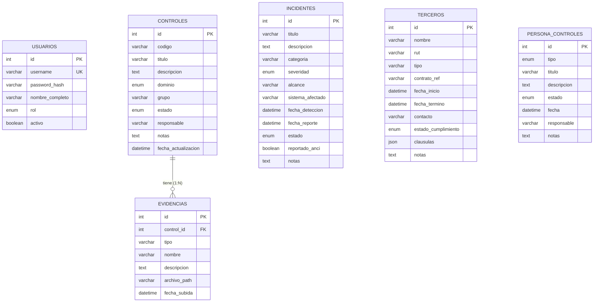

# 5. Diagrama del modelo de datos y diccionario de datos

> **Entregable 5 — Evaluación Sumativa 2 (ES2), Unidad 2 (Desarrollo e Implementación)**
> **Proyecto:** SGSI — Sistema de Gestión de Seguridad de la Información
> **Mandante:** Hospital Félix Bulnes Cerda (Miguel Godoy, Encargado de Ciberseguridad)
> **Criterio evaluado:** `2.1.2.5` — Diagrama del modelo de datos con su diccionario de datos.

Este entregable presenta el **modelo de datos relacional** de la solución (extraído del ORM real de
`sgsi/backend/app/models.py`) y su **diccionario de datos** completo, con tipos, claves, índices,
restricciones y catálogos de valores (enumeraciones).

---

## 5.1 Diagrama del modelo de datos (ER)

### 5.1.1 Diagrama (Mermaid)

### 5.1.2 Descripción del modelo

El modelo está compuesto por **6 tablas**:

| Tabla | Propósito |
|---|---|
| `usuarios` | Cuentas de acceso con rol para el control de acceso (RBAC). |
| `controles` | Catálogo de controles ISO/IEC 27001 (Anexo A) con estado y dominio. |
| `evidencias` | Archivos de evidencia asociados a un control. |
| `incidentes` | Incidentes de ciberseguridad clasificados según taxonomía ANCI. |
| `terceros` | Proveedores/terceros con cláusulas de seguridad y estado de cumplimiento. |
| `persona_controles` | Controles del dominio "Personas" (ciclo de vida del personal). |

**Relaciones:**
- `controles 1 — N evidencias` mediante la clave foránea `evidencias.control_id`, con borrado en
  cascada (`cascade="all, delete-orphan"`): al eliminar un control se eliminan sus evidencias.
- Las demás tablas (`usuarios`, `incidentes`, `terceros`, `persona_controles`) son independientes:
  en el modelo actual no registran autor/auditor de modificación por clave foránea.

> **Archivo editable:** `05_modelo_datos/05a_modelo_datos.drawio`

---

## 5.2 Diccionario de datos

### 5.2.1 Tabla `usuarios`

| Campo | Tipo | Nulo | Clave/Índice | Descripción |
|---|---|---|---|---|
| `id` | INT | No | PK | Identificador único del usuario. |
| `username` | VARCHAR | No | UQ, IX | Nombre de usuario para el inicio de sesión. |
| `password_hash` | VARCHAR | No | — | Hash de la contraseña (PBKDF2). |
| `nombre_completo` | VARCHAR | No | — | Nombre completo del usuario. |
| `rol` | ENUM(Role) | No | — | Rol de acceso: `encargado`, `admin_contratos`, `referente_tecnico`, `director`. |
| `activo` | BOOLEAN | Sí | — | Indica si la cuenta está activa (por defecto `true`). |

### 5.2.2 Tabla `controles`

| Campo | Tipo | Nulo | Clave/Índice | Descripción |
|---|---|---|---|---|
| `id` | INT | No | PK | Identificador único del control. |
| `codigo` | VARCHAR | Sí | IX | Código del control (ej. `A.5.1`). |
| `titulo` | VARCHAR | No | — | Título del control. |
| `descripcion` | TEXT | Sí | — | Descripción detallada del control. |
| `dominio` | ENUM(Dominio) | No | IX | Dominio del Anexo A: `organizacional`, `personas`, `fisico`, `tecnologico`. |
| `grupo` | VARCHAR | Sí | — | Grupo del control (ej. "5 Políticas de seguridad"). |
| `estado` | ENUM(EstadoControl) | Sí | IX | Estado: `no_iniciado`, `iniciado`, `implementado`, `gestionado`. |
| `responsable` | VARCHAR | Sí | — | Responsable del control. |
| `notas` | TEXT | Sí | — | Observaciones. |
| `fecha_actualizacion` | DATETIME | Sí | — | Última actualización (se refresca automáticamente). |

### 5.2.3 Tabla `evidencias`

| Campo | Tipo | Nulo | Clave/Índice | Descripción |
|---|---|---|---|---|
| `id` | INT | No | PK | Identificador único de la evidencia. |
| `control_id` | INT | No | FK → `controles.id` | Control al que pertenece la evidencia. |
| `tipo` | VARCHAR | Sí | — | Tipo de evidencia (por defecto `documento`). |
| `nombre` | VARCHAR | No | — | Nombre del archivo o evidencia. |
| `descripcion` | TEXT | Sí | — | Descripción de la evidencia. |
| `archivo_path` | VARCHAR | Sí | — | Ruta del archivo almacenado en el sistema de archivos. |
| `fecha_subida` | DATETIME | Sí | — | Fecha de carga de la evidencia. |

### 5.2.4 Tabla `incidentes`

| Campo | Tipo | Nulo | Clave/Índice | Descripción |
|---|---|---|---|---|
| `id` | INT | No | PK | Identificador único del incidente. |
| `titulo` | VARCHAR | No | — | Título del incidente. |
| `descripcion` | TEXT | Sí | — | Descripción del incidente. |
| `categoria` | VARCHAR | Sí | — | Categoría según taxonomía ANCI. |
| `severidad` | ENUM(Severidad) | No | IX | Severidad: `baja`, `media`, `alta`, `critica`. |
| `alcance` | VARCHAR | Sí | — | Alcance: `interno`, `externo`, `proveedor`. |
| `sistema_afectado` | VARCHAR | Sí | — | Sistema/módulo afectado (ej. "Trakcare – admisión de urgencias"). |
| `fecha_deteccion` | DATETIME | Sí | — | Fecha y hora de detección. |
| `fecha_reporte` | DATETIME | Sí | — | Fecha del reporte a la ANCI (si corresponde). |
| `estado` | ENUM(EstadoIncidente) | Sí | IX | Estado: `registrado`, `en_analisis`, `contenido`, `resuelto`, `reportado`, `cerrado`. |
| `reportado_anci` | BOOLEAN | Sí | — | Indica si fue reportado a la ANCI (por defecto `false`). |
| `notas` | TEXT | Sí | — | Observaciones. |

### 5.2.5 Tabla `terceros`

| Campo | Tipo | Nulo | Clave/Índice | Descripción |
|---|---|---|---|---|
| `id` | INT | No | PK | Identificador único del tercero. |
| `nombre` | VARCHAR | No | — | Nombre del proveedor/tercero. |
| `rut` | VARCHAR | Sí | — | RUT del tercero. |
| `tipo` | VARCHAR | Sí | — | Tipo (por defecto `proveedor_sistema`). |
| `contrato_ref` | VARCHAR | Sí | — | Referencia del contrato o licitación. |
| `fecha_inicio` | DATETIME | Sí | — | Inicio del contrato. |
| `fecha_termino` | DATETIME | Sí | — | Término del contrato. |
| `contacto` | VARCHAR | Sí | — | Contacto del tercero. |
| `estado_cumplimiento` | ENUM(EstadoCumplimiento) | Sí | — | `pendiente`, `parcial`, `cumple`, `no_cumple`. |
| `clausulas` | JSON | Sí | — | Lista de cláusulas de seguridad: `[{"nombre": str, "cumplida": bool}]`. |
| `notas` | TEXT | Sí | — | Observaciones. |

### 5.2.6 Tabla `persona_controles`

| Campo | Tipo | Nulo | Clave/Índice | Descripción |
|---|---|---|---|---|
| `id` | INT | No | PK | Identificador único del control de personas. |
| `tipo` | ENUM(TipoPersonaControl) | No | IX | Tipo de control del ciclo de vida del personal (ver catálogo). |
| `titulo` | VARCHAR | No | — | Título del control. |
| `descripcion` | TEXT | Sí | — | Descripción. |
| `estado` | ENUM(EstadoControl) | Sí | IX | Estado: `no_iniciado`, `iniciado`, `implementado`, `gestionado`. |
| `fecha` | DATETIME | Sí | — | Fecha del control (si aplica). |
| `responsable` | VARCHAR | Sí | — | Responsable. |
| `notas` | TEXT | Sí | — | Observaciones. |

---

## 5.3 Catálogos de valores (enumeraciones)

| Enumeración | Valores |
|---|---|
| `Role` | `encargado`, `admin_contratos`, `referente_tecnico`, `director` |
| `Dominio` | `organizacional`, `personas`, `fisico`, `tecnologico` |
| `EstadoControl` | `no_iniciado`, `iniciado`, `implementado`, `gestionado` |
| `Severidad` | `baja`, `media`, `alta`, `critica` |
| `EstadoIncidente` | `registrado`, `en_analisis`, `contenido`, `resuelto`, `reportado`, `cerrado` |
| `EstadoCumplimiento` | `pendiente`, `parcial`, `cumple`, `no_cumple` |
| `TipoPersonaControl` | `capacitacion`, `antecedentes`, `condiciones_empleo`, `disciplinario`, `termino_contrato`, `confidencialidad` |

---

## 5.4 Relaciones y cardinalidades

| Relación | Cardinalidad | Implementación |
|---|---|---|
| `controles` → `evidencias` | 1 : N | `evidencias.control_id` FK → `controles.id`, con borrado en cascada. |

---

## 5.5 Archivos `.drawio` generados

| Archivo | Diagrama |
|---|---|
| `05_modelo_datos/05a_modelo_datos.drawio` | Modelo entidad-relación (6 tablas con atributos, claves e índices). |

> **Nota:** para notación ER estricta (notación de pata de gallo / crow's foot), en draw.io activa la
> biblioteca **"Entity Relation"** (`+ Más formas → Software → Entity Relation`) y ajusta la relación
> `controles — evidencias` a 1:N.
