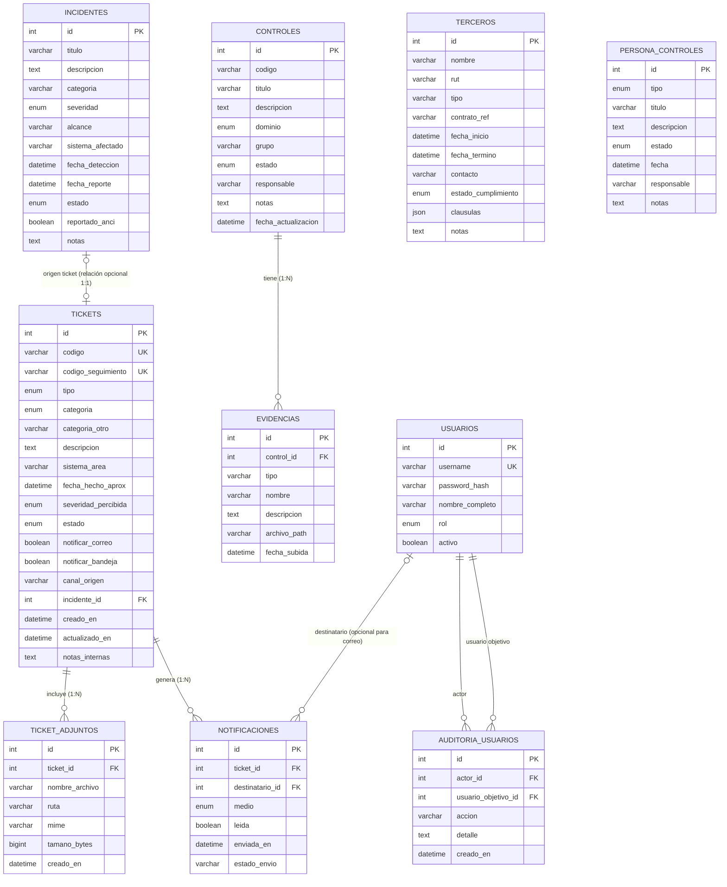

# 5. Diagrama del modelo de datos y diccionario de datos

> **Entregable 5 — Evaluación Sumativa 2 (ES2), Unidad 2 (Desarrollo e Implementación)**
> **Proyecto:** SGSI — Sistema de Gestión de Seguridad de la Información
> **Mandante:** Hospital Félix Bulnes Cerda (Miguel Godoy, Encargado de Ciberseguridad)
> **Criterio evaluado:** `2.1.2.5` — Diagrama del modelo de datos con su diccionario de datos.

Este entregable presenta el **modelo de datos relacional** documentado para la solución, incluyendo
las entidades existentes y la ampliación de Usuarios y Ticketera, junto con su **diccionario de datos**
con tipos, claves, índices, restricciones y catálogos de valores (enumeraciones).

---

## 5.1 Diagrama del modelo de datos (ER)

### 5.1.1 Diagrama (Mermaid)

### 5.1.2 Descripción del modelo

El modelo está compuesto por **10 tablas**:

| Tabla | Propósito |
|---|---|
| `usuarios` | Cuentas de acceso con rol para el control RBAC; el rol `admin_sistema` administra usuarios sin acceder al negocio ni a tickets. |
| `controles` | Catálogo de controles ISO/IEC 27001 (Anexo A) con estado y dominio. |
| `evidencias` | Archivos de evidencia asociados a un control. |
| `incidentes` | Incidentes de ciberseguridad clasificados según taxonomía ANCI. |
| `terceros` | Proveedores/terceros con cláusulas de seguridad y estado de cumplimiento. |
| `persona_controles` | Controles del dominio Personas (ciclo de vida del personal). |
| `tickets` | Denuncias y reportes de incidentes anónimos, con seguimiento por código y vínculo opcional a un incidente. |
| `ticket_adjuntos` | Metadatos y ruta segregada de archivos adjuntos de los tickets. |
| `notificaciones` | Avisos de bandeja y resultados de envío SMTP al equipo de ciberseguridad. |
| `auditoria_usuarios` | Trazabilidad de altas, cambios, reset de contraseña y habilitación/deshabilitación de cuentas. |

**Relaciones:**
- `controles 1 — N evidencias` mediante `evidencias.control_id`, con borrado en cascada de adjuntos de evidencia según la política del modelo.
- Cada ticket puede tener cero o un incidente derivado; el vínculo es uno a uno cuando existe. Los incidentes registrados por otros canales pueden no tener ticket.
- Un ticket puede tener varios adjuntos y notificaciones. Las notificaciones internas tienen destinatario usuario; los avisos SMTP se dirigen al buzón institucional y pueden no corresponder a una cuenta individual.
- Las notificaciones referencian a `usuarios`; la auditoría referencia a quien ejecuta la acción y a la cuenta objetivo. La deshabilitación no elimina usuarios ni su historial.
- **Anonimato por diseño:** `tickets` no incluye FK a `usuarios` ni campos de identidad del emisor. Esta decisión impide vincular una denuncia con una cuenta aunque se envíe desde una sesión autenticada o la persona solicite identificarse; el actor se omite deliberadamente para proteger la confidencialidad.

> **Archivo editable:** `05_modelo_datos/05a_modelo_datos.drawio`

## 5.2 Diccionario de datos

### 5.2.1 Tabla `usuarios`

| Campo | Tipo | Nulo | Clave/Índice | Descripción |
|---|---|---|---|---|
| `id` | INT | No | PK | Identificador único del usuario. |
| `username` | VARCHAR | No | UQ, IX | Nombre de usuario para el inicio de sesión. |
| `password_hash` | VARCHAR | No | — | Hash de la contraseña (PBKDF2). |
| `nombre_completo` | VARCHAR | No | — | Nombre completo del usuario. |
| `rol` | ENUM(Role) | No | IX | Rol de acceso: `encargado`, `admin_contratos`, `referente_tecnico`, `director`, `admin_sistema`. |
| `activo` | BOOLEAN | Sí | — | Indica si la cuenta está activa (por defecto `true`). |

### 5.2.2 Tabla `controles`

| Campo | Tipo | Nulo | Clave/Índice | Descripción |
|---|---|---|---|---|
| `id` | INT | No | PK | Identificador único del control. |
| `codigo` | VARCHAR | Sí | IX | Código del control (ej. `A.5.1`). |
| `titulo` | VARCHAR | No | — | Título del control. |
| `descripcion` | TEXT | Sí | — | Descripción detallada del control. |
| `dominio` | ENUM(Dominio) | No | IX | Dominio del Anexo A: `organizacional`, `personas`, `fisico`, `tecnologico`. |
| `grupo` | VARCHAR | Sí | — | Grupo del control (ej. "5 Políticas de seguridad"). |
| `estado` | ENUM(EstadoControl) | Sí | IX | Estado: `no_iniciado`, `iniciado`, `implementado`, `gestionado`. |
| `responsable` | VARCHAR | Sí | — | Responsable del control. |
| `notas` | TEXT | Sí | — | Observaciones. |
| `fecha_actualizacion` | DATETIME | Sí | — | Última actualización (se refresca automáticamente). |

### 5.2.3 Tabla `evidencias`

| Campo | Tipo | Nulo | Clave/Índice | Descripción |
|---|---|---|---|---|
| `id` | INT | No | PK | Identificador único de la evidencia. |
| `control_id` | INT | No | FK → `controles.id` | Control al que pertenece la evidencia. |
| `tipo` | VARCHAR | Sí | — | Tipo de evidencia (por defecto `documento`). |
| `nombre` | VARCHAR | No | — | Nombre del archivo o evidencia. |
| `descripcion` | TEXT | Sí | — | Descripción de la evidencia. |
| `archivo_path` | VARCHAR | Sí | — | Ruta del archivo almacenado en el sistema de archivos. |
| `fecha_subida` | DATETIME | Sí | — | Fecha de carga de la evidencia. |

### 5.2.4 Tabla `incidentes`

| Campo | Tipo | Nulo | Clave/Índice | Descripción |
|---|---|---|---|---|
| `id` | INT | No | PK | Identificador único del incidente. |
| `titulo` | VARCHAR | No | — | Título del incidente. |
| `descripcion` | TEXT | Sí | — | Descripción del incidente. |
| `categoria` | VARCHAR | Sí | — | Categoría según taxonomía ANCI. |
| `severidad` | ENUM(Severidad) | No | IX | Severidad: `baja`, `media`, `alta`, `critica`. |
| `alcance` | VARCHAR | Sí | — | Alcance: `interno`, `externo`, `proveedor`. |
| `sistema_afectado` | VARCHAR | Sí | — | Sistema/módulo afectado (ej. "Trakcare – admisión de urgencias"). |
| `fecha_deteccion` | DATETIME | Sí | — | Fecha y hora de detección. |
| `fecha_reporte` | DATETIME | Sí | — | Fecha del reporte a la ANCI (si corresponde). |
| `estado` | ENUM(EstadoIncidente) | Sí | IX | Estado: `registrado`, `en_analisis`, `contenido`, `resuelto`, `reportado`, `cerrado`. |
| `reportado_anci` | BOOLEAN | Sí | — | Indica si fue reportado a la ANCI (por defecto `false`). |
| `notas` | TEXT | Sí | — | Observaciones. |

### 5.2.5 Tabla `terceros`

| Campo | Tipo | Nulo | Clave/Índice | Descripción |
|---|---|---|---|---|
| `id` | INT | No | PK | Identificador único del tercero. |
| `nombre` | VARCHAR | No | — | Nombre del proveedor/tercero. |
| `rut` | VARCHAR | Sí | — | RUT del tercero. |
| `tipo` | VARCHAR | Sí | — | Tipo (por defecto `proveedor_sistema`). |
| `contrato_ref` | VARCHAR | Sí | — | Referencia del contrato o licitación. |
| `fecha_inicio` | DATETIME | Sí | — | Inicio del contrato. |
| `fecha_termino` | DATETIME | Sí | — | Término del contrato. |
| `contacto` | VARCHAR | Sí | — | Contacto del tercero. |
| `estado_cumplimiento` | ENUM(EstadoCumplimiento) | Sí | — | `pendiente`, `parcial`, `cumple`, `no_cumple`. |
| `clausulas` | JSON | Sí | — | Lista de cláusulas de seguridad: `[{"nombre": str, "cumplida": bool}]`. |
| `notas` | TEXT | Sí | — | Observaciones. |

### 5.2.6 Tabla `persona_controles`

| Campo | Tipo | Nulo | Clave/Índice | Descripción |
|---|---|---|---|---|
| `id` | INT | No | PK | Identificador único del control de personas. |
| `tipo` | ENUM(TipoPersonaControl) | No | IX | Tipo de control del ciclo de vida del personal (ver catálogo). |
| `titulo` | VARCHAR | No | — | Título del control. |
| `descripcion` | TEXT | Sí | — | Descripción. |
| `estado` | ENUM(EstadoControl) | Sí | IX | Estado: `no_iniciado`, `iniciado`, `implementado`, `gestionado`. |
| `fecha` | DATETIME | Sí | — | Fecha del control (si aplica). |
| `responsable` | VARCHAR | Sí | — | Responsable. |
| `notas` | TEXT | Sí | — | Observaciones. |

---

### 5.2.7 Tabla `tickets`

| Campo | Tipo | Nulo | Clave/Índice | Descripción |
|---|---|---|---|---|
| `id` | INT | No | PK | Identificador interno del ticket. |
| `codigo` | VARCHAR | No | UQ, IX | Código legible para trazabilidad (ej. `TCK-2026-00001`); no contiene identidad. |
| `codigo_seguimiento` | VARCHAR | No | UQ | Token aleatorio de consulta anónima; mantenerlo confidencial y no permitir enumeración. |
| `tipo` | ENUM(TipoTicket) | No | IX | `denuncia` o `reporte_incidente`. |
| `categoria` | ENUM(CategoriaTicket) | No | IX | Categoría del catálogo predefinido. |
| `categoria_otro` | VARCHAR | Sí | — | Texto libre requerido solo si la categoría es `otros`. |
| `descripcion` | TEXT | No | — | Descripción del hecho; contenido confidencial, visible solo a `encargado`. |
| `sistema_area` | VARCHAR | Sí | — | Sistema o área afectada, sin datos del emisor. |
| `fecha_hecho_aprox` | DATETIME | Sí | — | Fecha y hora aproximada del suceso. |
| `severidad_percibida` | ENUM(Severidad) | No | IX | Severidad percibida: `baja`, `media`, `alta` o `critica`. |
| `estado` | ENUM(EstadoTicket) | No | IX | Estado del ciclo: `registrado`, `en_analisis`, `derivado_a_incidente` o `cerrado`. |
| `notificar_correo` | BOOLEAN | No | — | Indica si se solicitó avisar al buzón del equipo por SMTP; no es correo del denunciante. |
| `notificar_bandeja` | BOOLEAN | No | — | Indica si se solicitaron avisos en la bandeja interna. |
| `canal_origen` | VARCHAR | No | IX | Origen `publico` o `interno`; no identifica persona ni autenticación. |
| `incidente_id` | INT | Sí | FK, UQ, IX | Incidente formal derivado (FK a `incidentes.id`); nullable y único para mantener relación opcional 1:1. |
| `creado_en` | DATETIME | No | IX | Fecha de registro y referencia de trazabilidad. |
| `actualizado_en` | DATETIME | No | IX | Fecha de última actualización del ticket. |
| `notas_internas` | TEXT | Sí | — | Notas de análisis restringidas al equipo de ciberseguridad; no se exponen en consulta pública ni correo. |

**Restricciones e índices:** códigos y código de seguimiento únicos; índice compuesto recomendado `(estado, creado_en)` para bandeja; índice en `(tipo, categoria)`; `incidente_id` nullable y único. CHECK: `categoria_otro` requerido si `categoria=otros`; al menos uno de los dos medios debe estar seleccionado; `canal_origen` limitado a `publico`/`interno`. No crear FK a usuarios ni almacenar nombre, correo, IP, user-agent o JWT del emisor.

### 5.2.8 Tabla `ticket_adjuntos`

| Campo | Tipo | Nulo | Clave/Índice | Descripción |
|---|---|---|---|---|
| `id` | INT | No | PK | Identificador del adjunto. |
| `ticket_id` | INT | No | FK, IX → `tickets.id` | Ticket al que pertenece; eliminar o retener según la política aplicable. |
| `nombre_archivo` | VARCHAR | No | — | Nombre saneado para presentación; no usarlo como ruta de almacenamiento. |
| `ruta` | VARCHAR | No | — | Ruta controlada en almacenamiento segregado (NAS, carpeta `/evidencias/tickets/`). |
| `mime` | VARCHAR | No | — | Tipo MIME validado contra lista blanca de extensiones y contenido. |
| `tamano_bytes` | BIGINT | No | — | Tamaño validado; máximo propuesto 10 MiB (10.485.760 bytes) por archivo. |
| `creado_en` | DATETIME | No | IX | Fecha de carga. |

**Restricciones:** FK a ticket; índice por `ticket_id`; CHECK de tamaño mayor a cero y dentro del límite; validar extensión, MIME real y escaneo antivirus recomendado. Restringir permisos de lectura/escritura y separar estos adjuntos de las evidencias generales.

### 5.2.9 Tabla `notificaciones`

| Campo | Tipo | Nulo | Clave/Índice | Descripción |
|---|---|---|---|---|
| `id` | INT | No | PK | Identificador de la notificación. |
| `ticket_id` | INT | No | FK, IX → `tickets.id` | Ticket que origina el aviso. |
| `destinatario_id` | INT | Sí | FK, IX → `usuarios.id` | Usuario destinatario de bandeja (rol `encargado`); nulo para correo a buzón institucional. |
| `medio` | ENUM(MedioNotificacion) | No | IX | `bandeja` o `correo`. |
| `leida` | BOOLEAN | No | IX | Marca de lectura para notificación de bandeja; queda en `false` para el correo. |
| `enviada_en` | DATETIME | Sí | IX | Momento de envío; nulo mientras está pendiente o en reintento. |
| `estado_envio` | VARCHAR | No | IX | Resultado operativo: `pendiente`, `enviado`, `fallido` o `reintento`. |

**Restricciones e índices:** FK a tickets; FK nullable a usuarios para avisos internos; índices por `(ticket_id)` y `(destinatario_id, leida)`. El correo contiene solo código, tipo, severidad y enlace a bandeja; el fallo SMTP no cancela el ticket y debe permitir reintento.

### 5.2.10 Tabla `auditoria_usuarios`

| Campo | Tipo | Nulo | Clave/Índice | Descripción |
|---|---|---|---|---|
| `id` | INT | No | PK | Identificador del evento de auditoría. |
| `actor_id` | INT | No | FK, IX → `usuarios.id` | Cuenta `admin_sistema` que ejecutó la acción. |
| `usuario_objetivo_id` | INT | No | FK, IX → `usuarios.id` | Cuenta sobre la que se realizó el cambio. |
| `accion` | VARCHAR | No | IX | Alta, edición de datos/rol, reset de contraseña, habilitación o deshabilitación. |
| `detalle` | TEXT | Sí | — | Detalle mínimo del cambio; no incluir contraseña, hash ni credenciales. |
| `creado_en` | DATETIME | No | IX | Fecha y hora del evento. |

**Restricciones e índices:** ambas claves foráneas referencian `usuarios.id` con conservación del historial; índices por actor, objetivo y fecha. Las cuentas se deshabilitan en lugar de borrarse para mantener la trazabilidad.

## 5.3 Catálogos de valores (enumeraciones)

| Enumeración | Valores |
|---|---|
| `Role` | `encargado`, `admin_contratos`, `referente_tecnico`, `director`, `admin_sistema` |
| `Dominio` | `organizacional`, `personas`, `fisico`, `tecnologico` |
| `EstadoControl` | `no_iniciado`, `iniciado`, `implementado`, `gestionado` |
| `Severidad` | `baja`, `media`, `alta`, `critica` |
| `EstadoIncidente` | `registrado`, `en_analisis`, `contenido`, `resuelto`, `reportado`, `cerrado` |
| `EstadoCumplimiento` | `pendiente`, `parcial`, `cumple`, `no_cumple` |
| `TipoPersonaControl` | `capacitacion`, `antecedentes`, `condiciones_empleo`, `disciplinario`, `termino_contrato`, `confidencialidad` |
| `TipoTicket` | `denuncia`, `reporte_incidente` |
| `CategoriaTicket` | `phishing`, `malware_ransomware`, `acceso_no_autorizado`, `fuga_de_informacion`, `uso_indebido_de_datos`, `falla_o_caida_de_servicio`, `perdida_robo_de_equipo`, `incumplimiento_de_politicas`, `otros` |
| `EstadoTicket` | `registrado`, `en_analisis`, `derivado_a_incidente`, `cerrado` |
| `MedioNotificacion` | `bandeja`, `correo` |

---

## 5.4 Relaciones y cardinalidades

| Relación | Cardinalidad | Implementación |
|---|---|---|
| `controles` → `evidencias` | 1 : N | FK `evidencias.control_id` → `controles.id`; las evidencias pertenecen a un control. |
| `tickets` → `incidentes` | 0..1 por ticket; 1 al convertir (1:1) | FK nullable y única `tickets.incidente_id` → `incidentes.id`. Cada ticket puede derivar cero o un incidente; una conversión genera un solo incidente. Los incidentes manuales pueden no tener ticket. |
| `tickets` → `ticket_adjuntos` | 1 : 0..N | FK `ticket_adjuntos.ticket_id` → `tickets.id`; un adjunto pertenece a un ticket. |
| `tickets` → `notificaciones` | 1 : 0..N | FK `notificaciones.ticket_id` → `tickets.id`; se registra por cada medio y resultado de envío. |
| `usuarios` → `notificaciones` | 1 : 0..N (destinatario opcional para SMTP) | FK nullable `notificaciones.destinatario_id` → `usuarios.id`; los destinatarios internos son usuarios `encargado` y el correo va al buzón institucional. |
| `usuarios` → `auditoria_usuarios` | 1 : 0..N como actor y como objetivo | FK `actor_id` y FK `usuario_objetivo_id` → `usuarios.id`. |

**Decisión de anonimato:** no existe relación entre `tickets` y `usuarios`. No se incorpora FK del emisor ni se guarda nombre, correo, IP, user-agent, token de sesión o dato de autenticación; así se evita la reidentificación incluso cuando se accede desde una sesión. El canal de origen registra solo `publico`/`interno`. Los registros de proxy para la ruta pública deben deshabilitarse o anonimizarse, y los logs de aplicación no deben capturar identidad o contenido sensible.

**Privacidad y retención:** restringir detalles y adjuntos de tickets al equipo de ciberseguridad; proteger la consulta con código aleatorio y respuestas sin datos sensibles. Separar adjuntos en `/evidencias/tickets/`, aplicar lista blanca, límites de tamaño y análisis antimalware recomendado. Los correos solo incluyen metadatos mínimos. Retener tickets, adjuntos, notificaciones y auditoría por los plazos que defina la política institucional y el área jurídica, minimizando datos y preservando obligaciones de trazabilidad; no se fija aquí un plazo no aprobado. Al vencer el plazo aprobado, eliminar de forma segura o anonimizar según corresponda. La baja de una cuenta es lógica y no borra sus registros de auditoría.

## 5.5 Archivos `.drawio` generados

| Archivo | Diagrama |
|---|---|
| `05_modelo_datos/05a_modelo_datos.drawio` | Modelo entidad-relación (10 tablas con atributos, claves e índices). |

> **Nota:** para notación ER estricta (notación de pata de gallo / crow's foot), en draw.io activa la
> biblioteca **"Entity Relation"** (`+ Más formas → Software → Entity Relation`) y ajusta las relaciones indicadas en la tabla 5.4.
