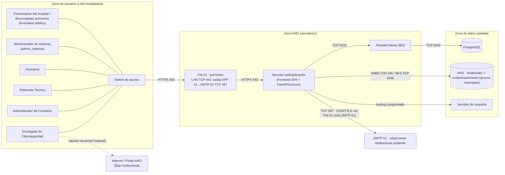

# 6. Diagrama de topología de comunicación

> **Entregable 6 — Evaluación Sumativa 2 (ES2), Unidad 2 (Desarrollo e Implementación)**
> **Proyecto:** SGSI — Sistema de Gestión de Seguridad de la Información
> **Mandante:** Hospital Félix Bulnes Cerda (Miguel Godoy, Encargado de Ciberseguridad)
> **Criterio evaluado:** `2.1.2.6` — Diagrama de la topología de comunicación que da soporte a la solución.

Este entregable describe la **topología de red** que soporta el SGSI, organizada en zonas de
seguridad separadas por firewalls, con los protocolos y puertos de cada flujo de comunicación. La
topología sigue el principio de **defensa en profundidad** y **mínimo privilegio**: los usuarios
acceden solo a la aplicación, la aplicación accede solo a los datos, y la zona de datos queda
aislada de la red de usuarios.

---

## 6.1 Descripción general

La solución se despliega en **tres zonas de comunicación**:

| Zona | Contenido | Función |
|---|---|---|
| **Zona de usuarios (LAN hospitalaria)** | Estaciones de trabajo de los cuatro roles existentes, `admin_sistema`, funcionarios del hospital y switch de acceso. | Acceso a la aplicación vía navegador (HTTPS); el formulario `/reportar` no requiere autenticación y permanece restringido a la LAN hospitalaria. |
| **Zona DMZ (servidores)** | Firewall perimetral, servidor web/aplicación (SPA + FastAPI/uvicorn) y firewall interno. | Publicar la aplicación y aplicar la lógica de negocio. |
| **Zona de datos (aislada)** | Servidor PostgreSQL, almacenamiento de evidencias (NAS) y servidor de respaldo. | Persistencia y respaldo; accesible solo desde la capa de aplicación. |

SMTP-01 corresponde al relay institucional existente, no a un nuevo servidor del SGSI; la aplicación solo puede iniciar conexión saliente hacia ese destino autorizado.

### 6.1.1 Decisiones clave

- **Aislamiento de la red clínica:** el SGSI **no se conecta** a Trakcare ni a la red asistencial;
  es un sistema de apoyo administrativo. Con esto se evita exponer el sistema clínico crítico.
- **Sin integración en línea con la ANCI:** el reporte de incidentes al portal ANCI lo realiza el
  Encargado de Ciberseguridad por el canal institucional (no existe conexión API del SGSI a la
  ANCI). En el diagrama se representa como flujo externo (línea punteada).
- **Firewall doble:** un firewall perimetral separa usuarios de la DMZ y un firewall interno separa
  la DMZ de la zona de datos.

---

### 6.1.2 Reglas de firewall propuestas

- **FW-01 (ingreso):** permitir desde la LAN hospitalaria únicamente TCP 443 hacia APP-01; bloquear cualquier acceso directo desde Internet. La ruta pública `/reportar` es anónima, pero solo se ofrece dentro de la red hospitalaria.
- **FW-01 (salida):** permitir desde APP-01 únicamente TCP 587 con STARTTLS hacia el relay institucional SMTP-01; denegar SMTP a destinos arbitrarios. Si la política institucional exige TCP 25 entre servidores internos, habilitarlo solo hacia el relay autorizado.
- **FW-02 (datos):** permitir TCP 5432 desde APP-01 hacia DB-01; habilitar solo el puerto de archivos aprobado entre APP-01 y NAS-01 (SMB3 TCP 445 o NFS TCP 2049, según estándar hospitalario).
- **Respaldos:** permitir solo los puertos documentados del agente BK-01, limitados a los nodos de origen/destino; no abrir reglas generales entre zonas.

## 6.2 Diagrama de topología (Mermaid)

---

## 6.3 Componentes de comunicación

| Componente | Zona | Función | Protocolo / Puerto |
|---|---|---|---|
| Estaciones de trabajo (cantidad referencial) | Usuarios autenticados y funcionarios del hospital | Acceso a la SPA y al formulario público | TCP 443 (HTTPS) |
| Switch de acceso | Usuarios | Conectividad LAN de los usuarios | Ethernet |
| Firewall perimetral | Perímetro/LAN-DMZ | Permite HTTPS desde la LAN a APP-01 y restringe la salida SMTP de APP-01 al relay autorizado | TCP 443 de entrada; TCP 587 de salida a SMTP-01 |
| Relay de correo institucional (SMTP-01) | Servicios institucionales | Recibe notificaciones emitidas por APP-01 | TCP 587 con STARTTLS; TCP 25 solo si lo exige la política interna |
| Servidor web/aplicación | DMZ | Sirve la SPA y ejecuta la API FastAPI/uvicorn | HTTPS 443 (entrada) |
| Firewall interno | DMZ/Datos | Restringe acceso a DB-01 y NAS-01 desde APP-01 | TCP 5432 a DB-01; TCP 445 (SMB3) o TCP 2049 (NFS) a NAS-01, según estándar |
| Servidor PostgreSQL | Datos | Persistencia de la base de datos | TCP 5432 |
| Almacenamiento de evidencias (NAS) | Datos | Guarda evidencias y adjuntos en carpetas separadas | SMB3 TCP 445 o NFS TCP 2049 |
| Servidor de respaldo | Datos | Copias de seguridad de BD y evidencias | Backup (rsync/agente) |

---

## 6.4 Flujos de comunicación

| # | Origen | Destino | Protocolo/Puerto | Propósito |
|---|---|---|---|---|
| F1 | Estaciones de trabajo y funcionarios del hospital | Firewall perimetral | TCP 443 (HTTPS) | Acceso a la SPA; incluye `/reportar` sin autenticación desde la LAN. |
| F2 | Firewall perimetral | Servidor web/aplicación | HTTPS 443 | Entrega de la aplicación. |
| F3 | Servidor web/aplicación | Firewall interno | TCP 5432 | Consultas a la base de datos. |
| F4 | Firewall interno | PostgreSQL | TCP 5432 | Acceso a datos (solo lectura/escritura de la app). |
| F5 | Servidor web/aplicación | NAS | SMB3 TCP 445 o NFS TCP 2049 | Carga/descarga de evidencias y adjuntos en carpeta restringida. |
| F6 | Servidor web/aplicación | Servidor de respaldo | Backup | Copias periódicas. |
| F7 | Estación del Encargado | Portal ANCI (Internet) | TCP 443 (HTTPS) | Reporte institucional de incidentes (manual, sin integración). |
| F8 | APP-01 | Relay de correo institucional SMTP-01 | TCP 587 (STARTTLS) | Envío de notificación con metadatos mínimos; salida permitida solo al relay autorizado. |

---

## 6.5 Nota sobre aislamiento con la red clínica

El SGSI es un sistema de **apoyo/gobernanza**, no asistencial. Por ello se mantiene **físicamente y
lógicamente aislado** de la red clínica (Trakcare): no existen flujos de comunicación entre ambas
redes. Si en el futuro se requiriera consultar datos clínicos, se haría mediante exportación manual
y anonimizada, nunca con conexión directa.

---

## 6.6 Archivos `.drawio` generados

| Archivo | Diagrama |
|---|---|
| `06_topologia/06a_topologia_comunicacion.drawio` | Topología de comunicación (3 zonas + firewalls + flujos). |

> **Nota:** los dispositivos de red se representan con formas estándar (rectángulos, cilindros para
> BD/NAS). Para íconos específicos (firewall, switch, servidor), en draw.io usa la biblioteca
> **"Redes"** (`+ Más formas → Redes`).
