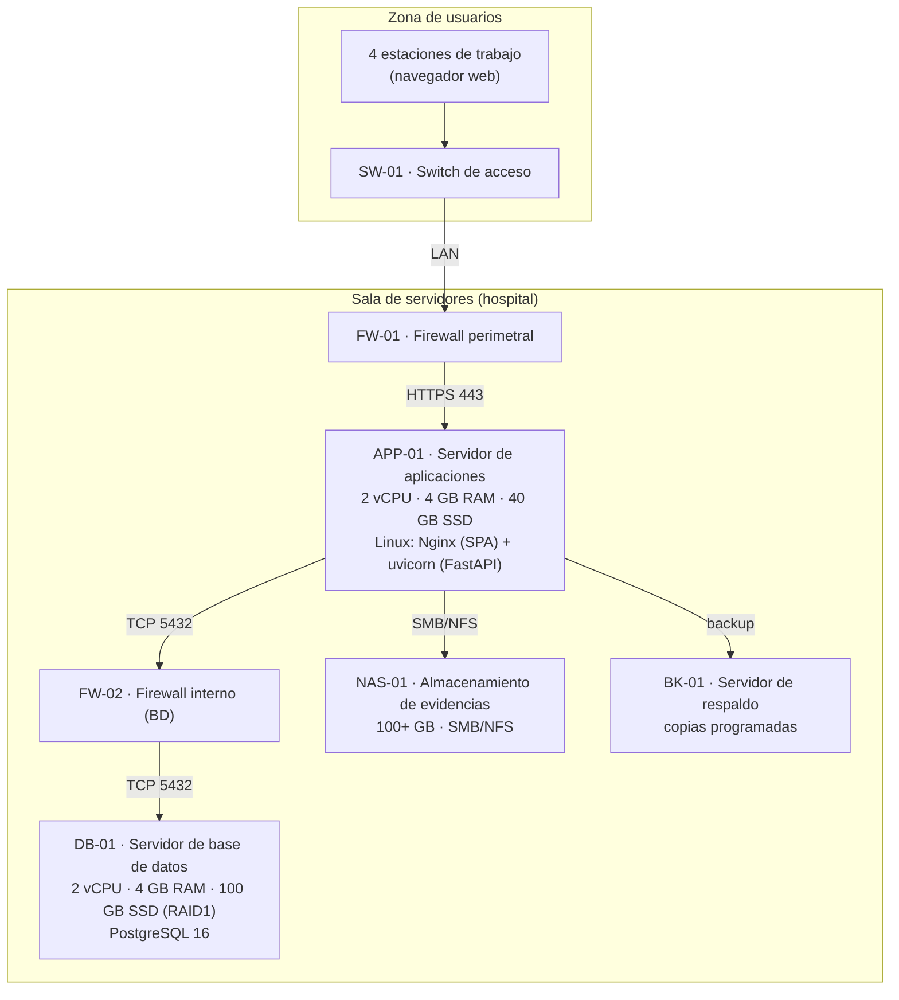

# 7. Diagrama de infraestructura

> **Entregable 7 — Evaluación Sumativa 2 (ES2), Unidad 2 (Desarrollo e Implementación)**
> **Proyecto:** SGSI — Sistema de Gestión de Seguridad de la Información
> **Mandante:** Hospital Félix Bulnes Cerda (Miguel Godoy, Encargado de Ciberseguridad)
> **Criterio evaluado:** `2.1.2.7` — Diagrama de diseño de la infraestructura que da soporte a la solución.

Este entregable describe la **infraestructura de TI** (componentes de hardware/software y su
dimensionamiento) sobre la que se despliega el SGSI. Complementa al Entregable 6 (topología de
comunicación) detallando **qué se ejecuta en cada componente** y sus capacidades.

> **Nota:** las capacidades son una **propuesta referencial** coherente con el Entregable 2; el
> hospital debe validar el dimensionamiento final según su política de infraestructura.

---

## 7.1 Descripción general

La infraestructura se organiza en dos áreas físicas:

| Área | Componentes | Función |
|---|---|---|
| **Sala de servidores (hospital)** | Firewalls, servidor de aplicaciones, servidor de base de datos, NAS de evidencias y servidor de respaldo. | Ejecutar y resguardar la aplicación y sus datos. |
| **Zona de usuarios** | Switch de acceso y estaciones de trabajo. | Acceso de los usuarios a la aplicación vía navegador. |

El patrón de despliegue es **cliente-servidor en 3 capas**: las estaciones de trabajo solo ejecutan
el navegador (cliente ligero); toda la lógica se concentra en el servidor de aplicaciones y los datos
en el servidor de base de datos y el NAS.

---

## 7.2 Diagrama de infraestructura (Mermaid)

---

## 7.3 Componentes de infraestructura

| Componente | Tipo | Especificación | Sistema operativo | Software instalado |
|---|---|---|---|---|
| **FW-01** | Firewall perimetral | Appliance o firewall por software | — | Reglas: permite solo HTTPS 443 hacia la aplicación. |
| **APP-01** | Servidor de aplicaciones | 2 vCPU · 4 GB RAM · 40 GB SSD | Linux (Debian/Ubuntu LTS) | Nginx (sirve la SPA compilada) + Uvicorn (FastAPI) + Python 3.14. |
| **FW-02** | Firewall interno | Appliance o firewall por software | — | Reglas: permite solo TCP 5432 desde APP-01 hacia DB-01. |
| **DB-01** | Servidor de base de datos | 2 vCPU · 4 GB RAM · 100 GB SSD (RAID1) | Linux | PostgreSQL 16. |
| **NAS-01** | Almacenamiento de evidencias | 100+ GB | Propio del NAS | SMB/NFS para guardar los archivos de evidencia. |
| **BK-01** | Servidor de respaldo | Según política de retención | — | Agente de backup de BD y evidencias (copias programadas). |
| **SW-01** | Switch de acceso | 24 puertos Gigabit | — | Conectividad LAN de la zona de usuarios. |
| **PC (×4)** | Estaciones de trabajo | 8 GB RAM · SSD | Windows / macOS / Linux | Navegador web actualizado (cliente de la SPA). |

---

## 7.4 Relación con el despliegue del software

| Componente de infraestructura | Software / artefacto desplegado |
|---|---|
| APP-01 | Frontend SPA compilado (Vite) servido por Nginx; API FastAPI ejecutada por Uvicorn en el puerto 8000 (publicada por HTTPS 443 vía proxy). |
| DB-01 | Base de datos `sgsi` (PostgreSQL). En desarrollo/pruebas se usa SQLite local. |
| NAS-01 | Carpeta `evidencias/` con los archivos subidos por los usuarios. |
| BK-01 | Copias de `sgsi.db`/PostgreSQL y de `evidencias/` (sustenta el plan de continuidad, Entregable 14). |

---

## 7.5 Archivos `.drawio` generados

| Archivo | Diagrama |
|---|---|
| `07_infraestructura/07a_infraestructura.drawio` | Diseño de infraestructura (sala de servidores + zona de usuarios). |

> **Nota:** para íconos específicos de infraestructura (servidor rack, NAS, firewall, switch), en
> draw.io usa la biblioteca **"Redes"** (`+ Más formas → Redes`).
