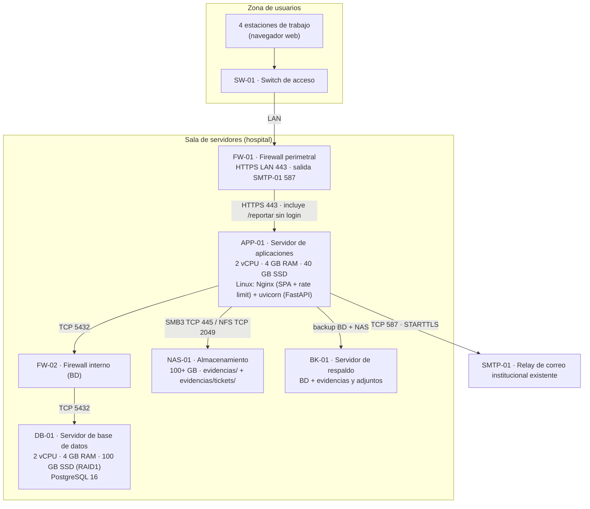

# 7. Diagrama de infraestructura

> **Entregable 7 — Evaluación Sumativa 2 (ES2), Unidad 2 (Desarrollo e Implementación)**
> **Proyecto:** SGSI — Sistema de Gestión de Seguridad de la Información
> **Mandante:** Hospital Félix Bulnes Cerda (Miguel Godoy, Encargado de Ciberseguridad)
> **Criterio evaluado:** `2.1.2.7` — Diagrama de diseño de la infraestructura que da soporte a la solución.

Este entregable describe la **infraestructura de TI** (componentes de hardware/software y su
dimensionamiento) sobre la que se despliega el SGSI. Complementa al Entregable 6 (topología de
comunicación) detallando **qué se ejecuta en cada componente** y sus capacidades.

> **Nota:** las capacidades son una **propuesta referencial** coherente con el Entregable 2; el
> hospital debe validar el dimensionamiento final según su política de infraestructura.

---

## 7.1 Descripción general

La infraestructura se organiza en dos áreas físicas:

| Área | Componentes | Función |
|---|---|---|
| **Sala de servidores (hospital)** | Firewalls, servidor de aplicaciones, servidor de base de datos, NAS de evidencias y servidor de respaldo. | Ejecutar y resguardar la aplicación y sus datos. |
| **Zona de usuarios** | Switch de acceso y estaciones de trabajo. | Acceso de los usuarios a la aplicación vía navegador. |

El patrón de despliegue es **cliente-servidor en 3 capas**: las estaciones de trabajo solo ejecutan
el navegador (cliente ligero); toda la lógica se concentra en el servidor de aplicaciones y los datos
en el servidor de base de datos y el NAS.

---

## 7.2 Diagrama de infraestructura (Mermaid)

---

## 7.3 Componentes de infraestructura

| Componente | Tipo | Especificación | Sistema operativo | Software instalado |
|---|---|---|---|---|
| **FW-01** | Firewall perimetral | Appliance o firewall por software | — | Permite HTTPS 443 desde la LAN a APP-01; salida SMTP desde APP-01 solo a SMTP-01 por TCP 587 (STARTTLS). No se publica el formulario a Internet. |
| **APP-01** | Servidor de aplicaciones | 2 vCPU · 4 GB RAM · 40 GB SSD (sin cambio propuesto) | Linux (Debian/Ubuntu LTS) | Nginx (SPA, proxy inverso y `limit_req` para `/api/public/tickets`) + Uvicorn (FastAPI) + Python 3.14; servicio de notificaciones con envío SMTP reintentable. |
| **FW-02** | Firewall interno | Appliance o firewall por software | — | Permite TCP 5432 desde APP-01 a DB-01 y solo el puerto aprobado de archivos desde APP-01 a NAS-01 (SMB3 TCP 445 o NFS TCP 2049). |
| **DB-01** | Servidor de base de datos | 2 vCPU · 4 GB RAM · 100 GB SSD (RAID1) | Linux | PostgreSQL 16. |
| **NAS-01** | Almacenamiento de evidencias y adjuntos | 100+ GB (capacidad existente; validar espacio libre y retención) | Propio del NAS | Carpetas separadas `evidencias/` y `evidencias/tickets/`, con permisos restringidos al servicio SGSI. |
| **BK-01** | Servidor de respaldo | Según política de retención | — | Backup consistente de PostgreSQL (incluye tickets, adjuntos, notificaciones y auditoría de usuarios) y de las carpetas de evidencias y adjuntos. |
| **SMTP-01** | Servicio institucional existente | Relay/correo institucional; sin hardware SGSI nuevo | Gestionado por el hospital | Recepción de correo saliente de APP-01 vía TCP 587/STARTTLS; credenciales y buzón de destino se validan con TI. |
| **SW-01** | Switch de acceso | 24 puertos Gigabit | — | Conectividad LAN de la zona de usuarios. |
| **PC (×4)** | Estaciones de trabajo | 8 GB RAM · SSD | Windows / macOS / Linux | Navegador web actualizado (cliente de la SPA). |

---

## 7.4 Relación con el despliegue del software

| Componente de infraestructura | Software / artefacto desplegado |
|---|---|
| APP-01 | Frontend SPA compilado (Vite) servido por Nginx; API FastAPI ejecutada por Uvicorn en el puerto 8000 (publicada por HTTPS 443 vía proxy). |
| DB-01 | Base de datos `sgsi` (PostgreSQL). En desarrollo/pruebas se usa SQLite local. |
| NAS-01 | Carpetas `evidencias/` y `evidencias/tickets/` para archivos de evidencia y adjuntos de tickets, con acceso separado. |
| BK-01 | Copias consistentes de PostgreSQL (incluidas las nuevas tablas) y de `evidencias/` + `evidencias/tickets/`; restauración verificada según el plan de continuidad (Entregable 14). |

---

## 7.5 Dimensionamiento, respaldo y seguridad

- **Dimensionamiento sin cambio de hardware:** se mantienen APP-01 (2 vCPU, 4 GB RAM, 40 GB SSD), DB-01 (2 vCPU, 4 GB RAM, 100 GB SSD RAID1), NAS-01 (100+ GB) y BK-01. El relay SMTP es un servicio institucional existente, no un servidor nuevo del SGSI; tampoco se requiere un worker dedicado para el volumen previsto.
- **Estimación de almacenamiento, supuesto de planificación:** con 100 tickets al mes, hasta 2 adjuntos por ticket y un máximo de 10 MB por archivo, el crecimiento bruto sería de hasta 24 GB/año, sin contar copias de respaldo. Es una hipótesis de dimensionamiento, no una medición de demanda; TI debe verificar el espacio libre, la retención y la capacidad de respaldo del NAS antes de producción. Si el volumen real excede la capacidad disponible, se justificaría una ampliación por separado.
- **Respaldo:** incluir en la misma política las tablas `tickets`, `ticket_adjuntos`, `notificaciones` y `auditoria_usuarios`, además de la carpeta `evidencias/tickets/`; conservar consistencia entre referencias de BD y archivos, cifrar/limitar el acceso a copias y probar restauración periódicamente.
- **Seguridad y anonimato:** el formulario público solo se ofrece desde la LAN y no solicita credenciales; tickets no almacenan identidad, IP ni user-agent del emisor. Nginx limita solicitudes en la ruta pública; no registrar cuerpo, adjuntos ni IP de esa ruta. Validar tipo y tamaño de archivos (máximo propuesto 10 MB), aplicar lista blanca y análisis antimalware recomendado; proteger `evidencias/tickets/` con permisos mínimos. Solo el rol encargado accede al contenido y ciclo de vida de tickets; `admin_sistema` no tiene acceso. El correo usa STARTTLS y contiene solo código, tipo, severidad y enlace a la bandeja, no el contenido de la denuncia.

## 7.6 Archivos `.drawio` generados

| Archivo | Diagrama |
|---|---|
| `07_infraestructura/07a_infraestructura.drawio` | Diseño de infraestructura (sala de servidores + zona de usuarios). |

> **Nota:** para íconos específicos de infraestructura (servidor rack, NAS, firewall, switch), en
> draw.io usa la biblioteca **"Redes"** (`+ Más formas → Redes`).
