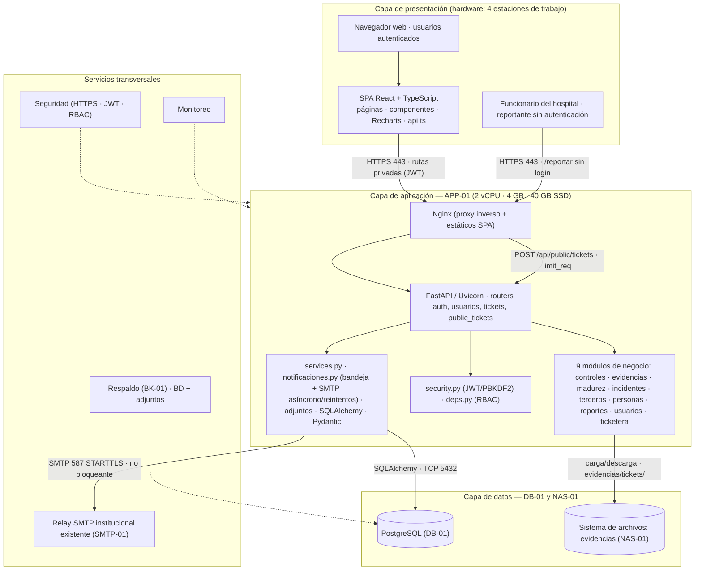

# 8. Diagrama de arquitectura de la solución

> **Entregable 8 — Evaluación Sumativa 2 (ES2), Unidad 2 (Desarrollo e Implementación)**
> **Proyecto:** SGSI — Sistema de Gestión de Seguridad de la Información
> **Mandante:** Hospital Félix Bulnes Cerda (Miguel Godoy, Encargado de Ciberseguridad)
> **Criterio evaluado:** `2.1.2.8` — Diagrama de arquitectura de la solución, especificando los
> componentes de infraestructura TI, tanto de **software** como de **hardware**.

Este entregable presenta la **arquitectura de la solución** en 3 capas (presentación, aplicación y
datos) más los **servicios transversales**, indicando para cada componente de software el
**hardware** sobre el que se ejecuta, así como las **interfaces** entre capas. El canal público de
tickets no requiere autenticación, pero se expone solo a través de la red interna del hospital; las
rutas de negocio restantes mantienen autenticación y autorización RBAC.

---

## 8.1 Descripción de la arquitectura

Se adopta una **arquitectura monolítica modular en 3 capas** (estilo cliente-servidor), adecuada al
alcance del proyecto: una sola institución, volumen transaccional bajo, equipo de 3 estudiantes y
plazo de un semestre. Las capas son:

| Capa | Software | Hardware |
|---|---|---|
| **Presentación** | Navegador web + SPA (React + TypeScript + Vite + Recharts) | 4 estaciones de trabajo (8 GB RAM · SSD) |
| **Aplicación** | Nginx (proxy inverso) + Uvicorn/FastAPI (módulos de negocio, seguridad y ORM) | APP-01 (2 vCPU · 4 GB RAM · 40 GB SSD) |
| **Datos** | PostgreSQL + sistema de archivos de evidencias | DB-01 (2 vCPU · 4 GB RAM · 100 GB RAID1) y NAS-01 (100+ GB) |
| **Transversales** | Seguridad (HTTPS/JWT/RBAC), monitoreo y respaldo | FW-01/FW-02 y BK-01 |

---

## 8.2 Diagrama de arquitectura (Mermaid)

---

## 8.3 Componentes de software y su hardware

| Componente de software | Descripción | Hardware de soporte |
|---|---|---|
| SPA (React + TS + Vite) | Interfaz de usuario con gráficos de madurez | Estaciones de trabajo (navegador) |
| Nginx | Sirve la SPA compilada y hace de proxy inverso hacia la API | APP-01 |
| FastAPI/Uvicorn | API REST con 9 módulos de negocio; rutas públicas y privadas separadas | APP-01 |
| Router `usuarios` | CRUD y auditoría de usuarios; acceso exclusivo de `admin_sistema` | APP-01 |
| Routers `tickets` / `public_tickets` | Bandeja protegida para `encargado` y creación pública sin JWT en `/api/public/tickets` | APP-01 |
| `security.py` / `deps.py` | Autenticación JWT + hash PBKDF2 + control de acceso RBAC | APP-01 |
| `services.py` / `notificaciones.py` | Reglas de negocio; bandeja interna y envío SMTP asíncrono con reintentos, sin bloquear la creación del ticket | APP-01 |
| ORM SQLAlchemy + Pydantic | Mapeo de entidades y validación de esquemas | APP-01 |
| PostgreSQL | Base de datos relacional (SQLite en desarrollo) | DB-01 |
| Sistema de archivos | Evidencias y adjuntos de tickets en `evidencias/tickets/`, con permisos restringidos | NAS-01 |
| Relay SMTP institucional | Servicio existente para notificar al equipo; mensaje limitado a código, tipo, severidad y enlace | SMTP-01 (hospital) |
| Firewalls | Filtrado de tráfico entre zonas | FW-01 / FW-02 |
| Respaldo | Copias de BD y evidencias | BK-01 |

---

## 8.4 Interfaces entre componentes

| Interfaz | Origen → Destino | Protocolo/Formato |
|---|---|---|
| Cliente → Aplicación privada | SPA → Nginx/FastAPI | HTTPS 443 · JSON REST · JWT para rutas protegidas |
| Formulario público → API | Navegador de la LAN → Nginx → `POST /api/public/tickets` | HTTPS 443 · JSON/multipart · sin JWT; limitación de solicitudes en Nginx |
| Proxy → API | Nginx → Uvicorn | HTTP interno (localhost) |
| Aplicación → Datos | SQLAlchemy → PostgreSQL | TCP 5432 · SQL |
| Aplicación → Archivos | Módulos de evidencias/tickets → NAS | SMB3 TCP 445 o NFS TCP 2049, según regla aprobada; carpeta de tickets separada |
| Aplicación → Correo | `notificaciones.py` en APP-01 → SMTP-01 | SMTP TCP 587 con STARTTLS; salida restringida al relay |
| Autenticación | Cliente → `auth` | Token JWT requerido en rutas privadas; excepción solo para el formulario público y consulta anónima de estado |
| Respaldo | BK-01 → DB/NAS | Agente de backup programado |

---

## 8.5 Decisiones de arquitectura

1. **Monolito modular (no microservicios):** menor complejidad de despliegue y mantenimiento, sin
   renunciar a la separación por módulo de negocio (cada dominio queda encapsulado y es reemplazable
   a futuro).
2. **API REST documentada (OpenAPI/Swagger):** facilita pruebas y auditoría del SGSI.
3. **Base de datos intercambiable (SQLAlchemy):** SQLite para desarrollo/demostración y PostgreSQL en
   producción, sin modificar código (variable `SGSI_DATABASE_URL`).
4. **Sin integración en línea con Trakcare ni con la ANCI:** el SGSI es un sistema de apoyo; evita
   exponer el sistema clínico crítico.
5. **ADR-05 — Tickets anónimos sin FK a usuarios:** la tabla `tickets` no referencia a `usuarios` ni guarda
   identidad, IP o user-agent del emisor. La trazabilidad se realiza con código, fecha y estado; los adjuntos
   se almacenan en una carpeta restringida. Esta decisión prioriza anonimato y minimización de datos.
6. **ADR-06 — Endpoint público acotado y protegido:** se permite el acceso sin autenticación únicamente a las rutas
   públicas definidas (`POST /api/public/tickets`, categorías y consulta por código). El acceso se limita a la
   LAN hospitalaria; Nginx aplica rate limiting y la API valida y sanitiza entradas/adjuntos. El resto de la API
   exige JWT y autorización RBAC.
7. **ADR-07 — Notificación asíncrona y tolerante a fallos:** registrar el ticket no depende de la disponibilidad
   de SMTP. Se conserva la notificación interna y se reintenta el correo; se envían solo metadatos mínimos,
   sin contenido sensible, para evitar pérdida de reportes y exposición de denuncias.

---

## 8.6 Archivos `.drawio` generados

| Archivo | Diagrama |
|---|---|
| `08_arquitectura/08a_arquitectura_solucion.drawio` | Arquitectura de la solución (3 capas + transversales). |

> **Nota:** para íconos de componentes específicos, en draw.io usa las bibliotecas **"UML"** o
> **"Redes"** (`+ Más formas → Software/Redes`).
