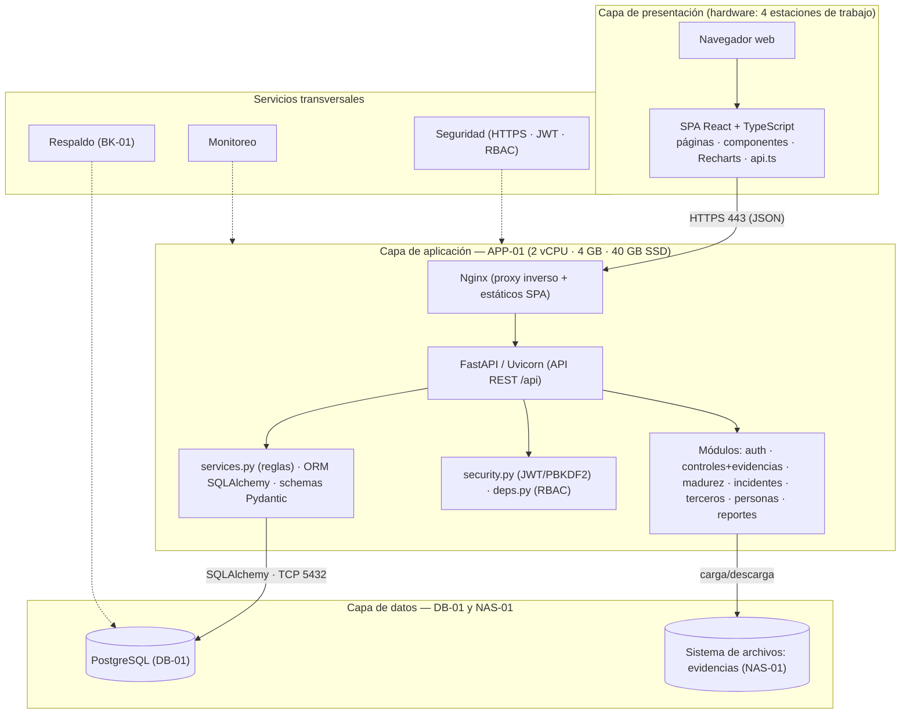

# 8. Diagrama de arquitectura de la solución

> **Entregable 8 — Evaluación Sumativa 2 (ES2), Unidad 2 (Desarrollo e Implementación)**
> **Proyecto:** SGSI — Sistema de Gestión de Seguridad de la Información
> **Mandante:** Hospital Félix Bulnes Cerda (Miguel Godoy, Encargado de Ciberseguridad)
> **Criterio evaluado:** `2.1.2.8` — Diagrama de arquitectura de la solución, especificando los
> componentes de infraestructura TI, tanto de **software** como de **hardware**.

Este entregable presenta la **arquitectura de la solución** en 3 capas (presentación, aplicación y
datos) más los **servicios transversales**, indicando para cada componente de software el
**hardware** sobre el que se ejecuta, así como las **interfaces** entre capas.

---

## 8.1 Descripción de la arquitectura

Se adopta una **arquitectura monolítica modular en 3 capas** (estilo cliente-servidor), adecuada al
alcance del proyecto: una sola institución, volumen transaccional bajo, equipo de 3 estudiantes y
plazo de un semestre. Las capas son:

| Capa | Software | Hardware |
|---|---|---|
| **Presentación** | Navegador web + SPA (React + TypeScript + Vite + Recharts) | 4 estaciones de trabajo (8 GB RAM · SSD) |
| **Aplicación** | Nginx (proxy inverso) + Uvicorn/FastAPI (módulos de negocio, seguridad y ORM) | APP-01 (2 vCPU · 4 GB RAM · 40 GB SSD) |
| **Datos** | PostgreSQL + sistema de archivos de evidencias | DB-01 (2 vCPU · 4 GB RAM · 100 GB RAID1) y NAS-01 (100+ GB) |
| **Transversales** | Seguridad (HTTPS/JWT/RBAC), monitoreo y respaldo | FW-01/FW-02 y BK-01 |

---

## 8.2 Diagrama de arquitectura (Mermaid)

---

## 8.3 Componentes de software y su hardware

| Componente de software | Descripción | Hardware de soporte |
|---|---|---|
| SPA (React + TS + Vite) | Interfaz de usuario con gráficos de madurez | Estaciones de trabajo (navegador) |
| Nginx | Sirve la SPA compilada y hace de proxy inverso hacia la API | APP-01 |
| FastAPI/Uvicorn | API REST con los 7 módulos de negocio | APP-01 |
| `security.py` / `deps.py` | Autenticación JWT + hash PBKDF2 + control de acceso RBAC | APP-01 |
| `services.py` | Reglas de negocio: plazos legales (3h/72h/15d) y madurez | APP-01 |
| ORM SQLAlchemy + Pydantic | Mapeo de entidades y validación de esquemas | APP-01 |
| PostgreSQL | Base de datos relacional (SQLite en desarrollo) | DB-01 |
| Sistema de archivos | Almacenamiento de evidencias | NAS-01 |
| Firewalls | Filtrado de tráfico entre zonas | FW-01 / FW-02 |
| Respaldo | Copias de BD y evidencias | BK-01 |

---

## 8.4 Interfaces entre componentes

| Interfaz | Origen → Destino | Protocolo/Formato |
|---|---|---|
| Cliente → Aplicación | SPA → Nginx/FastAPI | HTTPS · JSON (REST) |
| Proxy → API | Nginx → Uvicorn | HTTP interno (localhost) |
| Aplicación → Datos | SQLAlchemy → PostgreSQL | TCP 5432 · SQL |
| Aplicación → Archivos | Módulo evidencias → NAS | SMB/NFS |
| Autenticación | Cliente → `auth` | JWT Bearer token |
| Respaldo | BK-01 → DB/NAS | Agente de backup programado |

---

## 8.5 Decisiones de arquitectura

1. **Monolito modular (no microservicios):** menor complejidad de despliegue y mantenimiento, sin
   renunciar a la separación por módulo de negocio (cada dominio queda encapsulado y es reemplazable
   a futuro).
2. **API REST documentada (OpenAPI/Swagger):** facilita pruebas y auditoría del SGSI.
3. **Base de datos intercambiable (SQLAlchemy):** SQLite para desarrollo/demostración y PostgreSQL en
   producción, sin modificar código (variable `SGSI_DATABASE_URL`).
4. **Sin integración en línea con Trakcare ni con la ANCI:** el SGSI es un sistema de apoyo; evita
   exponer el sistema clínico crítico.

---

## 8.6 Archivos `.drawio` generados

| Archivo | Diagrama |
|---|---|
| `08_arquitectura/08a_arquitectura_solucion.drawio` | Arquitectura de la solución (3 capas + transversales). |

> **Nota:** para íconos de componentes específicos, en draw.io usa las bibliotecas **"UML"** o
> **"Redes"** (`+ Más formas → Software/Redes`).
