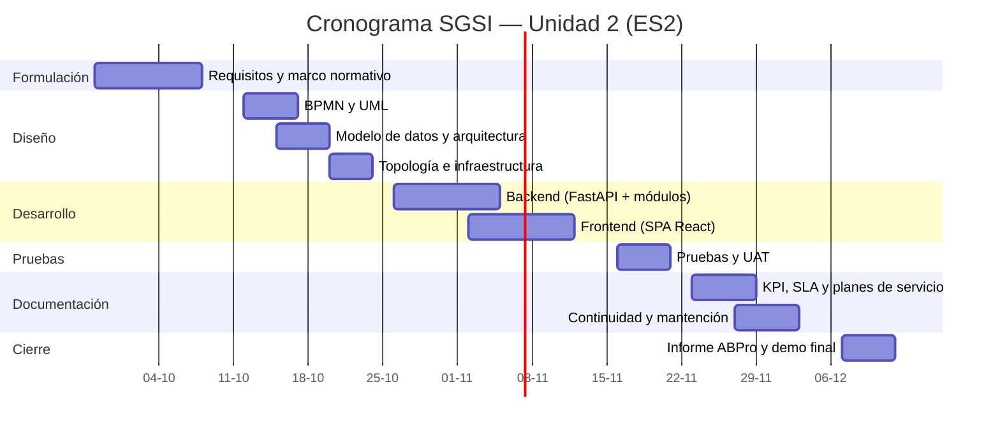

# 16. Carta Gantt / detalle de fases

> **Entregable 16 — Evaluación Sumativa 2 (ES2), Unidad 2 (Desarrollo e Implementación)**
> **Proyecto:** SGSI — Sistema de Gestión de Seguridad de la Información
> **Mandante:** Hospital Félix Bulnes Cerda (Miguel Godoy, Encargado de Ciberseguridad)
> **Criterio evaluado:** `2.1.6.16` — Planificación en carta Gantt (métodos predictivos) o detalle de
> fases (métodos adaptativos).

Dado que el proyecto adopta una **metodología ágil (Scrum)**, la planificación se presenta como
**detalle de fases/sprints**, acompañada de una **carta Gantt de referencia** con los hitos de entrega.

---

## 16.1 Metodología de planificación

Scrum organiza el trabajo en **sprints semanales** con un **incremento entregable** al final de cada
etapa, alineado a los hitos de la asignatura (avance EF2 → entrega ES2).

## 16.2 Detalle de fases (sprints)

| Fase | Duración | Actividades principales | Entregable / Hito |
|---|---|---|---|
| F1. Formulación y requisitos | 2 semanas | Refinar requerimientos con el mandante; marco normativo | Avance formativo (EF2) |
| F2. Diseño | 2 semanas | BPMN, UML (casos de uso, componentes), modelo de datos, arquitectura, infraestructura y topología | Entregables 3–8 |
| F3. Desarrollo backend | 2 semanas | API FastAPI, módulos de negocio, JWT/RBAC, reglas de madurez y plazos | Backend operativo |
| F4. Desarrollo frontend | 2 semanas | SPA React, páginas, dashboard y reportes | Frontend integrado |
| F5. Pruebas | 1 semana | Pruebas unitarias, de sistema y UAT (Entregable 11) | Sistema validado |
| F6. Documentación ES2 | 2 semanas | KPI, SLA, planes de servicio y continuidad, mantención | Entregables 9–15 |
| F7. Cierre y presentación | 1 semana | Informe ABPro, demo y presentación final | Entrega sumativa (ES2) |

## 16.3 Carta Gantt (referencia)

## 16.4 Hitos de entrega

| Hito | Fecha | Entregable |
|---|---|---|
| Avance formativo (EF2) | 09-10-2026 | Pre-informe / avance |
| Diseño completo | 23-10-2026 | Entregables 3–8 |
| Sistema integrado | 13-11-2026 | Backend + Frontend |
| Validación (UAT) | 20-11-2026 | Plan de pruebas ejecutado |
| Entrega sumativa (ES2) | 11-12-2026 | Informe final ABPro + demo |

## 16.5 Gestión del cronograma

- **Revisión por sprint:** al cierre de cada sprint se revisa el avance y se re-prioriza el backlog.
- **Buffers:** las fases de desarrollo incluyen 1 semana de holgura para absorver ajustes del
  mandante (detalle en la justificación del cronograma, Entregable 17).
