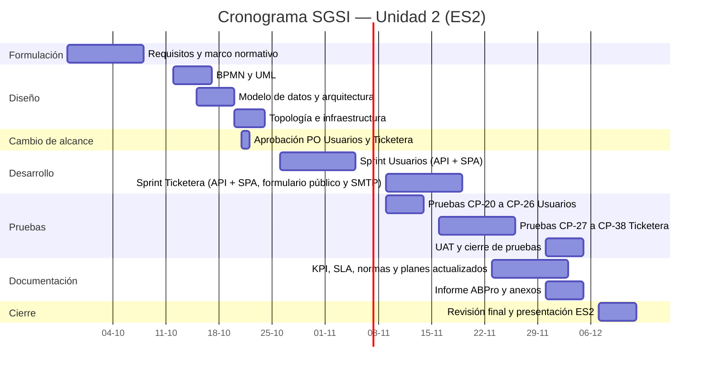

# 16. Carta Gantt / detalle de fases

> **Entregable 16 — Evaluación Sumativa 2 (ES2), Unidad 2 (Desarrollo e Implementación)**
> **Proyecto:** SGSI — Sistema de Gestión de Seguridad de la Información
> **Mandante:** Hospital Félix Bulnes Cerda (Miguel Godoy, Encargado de Ciberseguridad)
> **Criterio evaluado:** `2.1.6.16` — Planificación en carta Gantt (métodos predictivos) o detalle de
> fases (métodos adaptativos).

Dado que el proyecto adopta una **metodología ágil (Scrum)**, la planificación se presenta como
**detalle de fases/sprints**, acompañada de una **carta Gantt de referencia** con los hitos de entrega.

---

## 16.1 Metodología de planificación

Scrum organiza el trabajo en **sprints con incrementos entregables** al final de cada etapa; su
duración se ajusta a las dependencias del alcance y a los hitos de la asignatura (EF2 → ES2).

## 16.2 Detalle de fases (sprints)

| Fase | Duración | Actividades principales | Entregable / Hito |
|---|---|---|---|
| F1. Formulación y requisitos | 2 semanas | Refinar requerimientos con el mandante; marco normativo | Avance formativo (EF2) |
| F2. Diseño | 2 semanas | BPMN, UML (casos de uso, componentes), modelo de datos, arquitectura, infraestructura y topología | Entregables 3–8 |
| F3. Sprint Usuarios | 2 semanas | Backend y frontend del CRUD; RBAC para `admin_sistema`, baja lógica, auditoría y pruebas unitarias | Módulo Usuarios integrado |
| F4. Sprint Ticketera | 2 semanas | Formulario público, bandeja interna, adjuntos, notificaciones SMTP/bandeja y conversión a incidente; se inicia después del sprint Usuarios | Módulo Ticketera integrado |
| F5. Pruebas | 4 semanas | Pruebas funcionales CP-01–CP-16 y CP-20–CP-38, seguridad, rendimiento y UAT (Entregable 11) | Sistema validado |
| F6. Documentación ES2 | 2 semanas | Actualización de KPI, SLA, normas, planes de servicio, continuidad y mantención | Entregables 9–15 actualizados |
| F7. Cierre y presentación | 1 semana | Informe ABPro, demo y presentación final | Entrega sumativa (ES2) |

## 16.3 Carta Gantt (referencia)

## 16.4 Hitos de entrega

| Hito | Fecha | Entregable |
|---|---|---|
| Avance formativo (EF2) | 09-10-2026 | Pre-informe / avance |
| Cambio Mayor aprobado | 21-10-2026 | Incorporación de Usuarios y Ticketera, aprobado por el Product Owner |
| Diseño actualizado | 23-10-2026 | Ajustes de requisitos, BPMN/UML, datos y arquitectura |
| Módulo Usuarios integrado | 06-11-2026 | Sprint Usuarios y CP-20 a CP-26 |
| Módulo Ticketera integrado | 20-11-2026 | Sprint Ticketera y canal público con notificaciones |
| Validación (UAT) | 04-12-2026 | CP-01 a CP-16 y CP-20 a CP-38; pruebas y aceptación |
| Entrega sumativa (ES2) | 11-12-2026 | Informe final ABPro + demo |

## 16.5 Gestión del cronograma

- **Revisión por sprint:** al cierre de cada sprint se revisa el avance y se re-prioriza el backlog.
- **Cambio de alcance:** la incorporación de Usuarios y Ticketera fue formalizada el 21-10-2026 y gestionada como cambio Mayor con aprobación del Product Owner.
- **Secuencia:** primero se implementa Usuarios y luego Ticketera, conforme al acuerdo con el mandante; el diseño, la preparación de pruebas y la documentación pueden solaparse para proteger el hito.
- **Buffers:** se conserva holgura mediante solapamiento controlado entre pruebas, documentación y cierre; la fecha ES2 del 11-12-2026 se mantiene.
